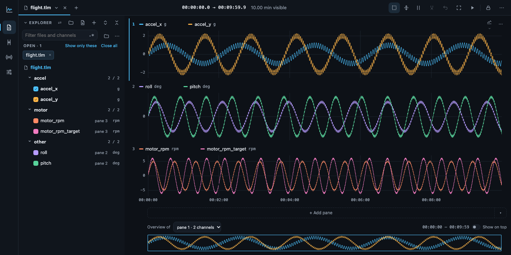
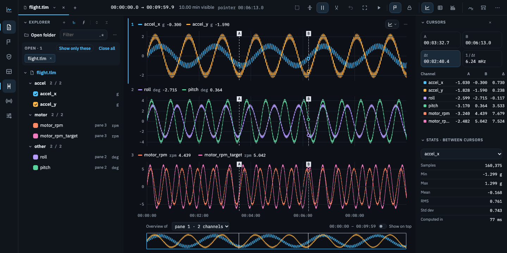
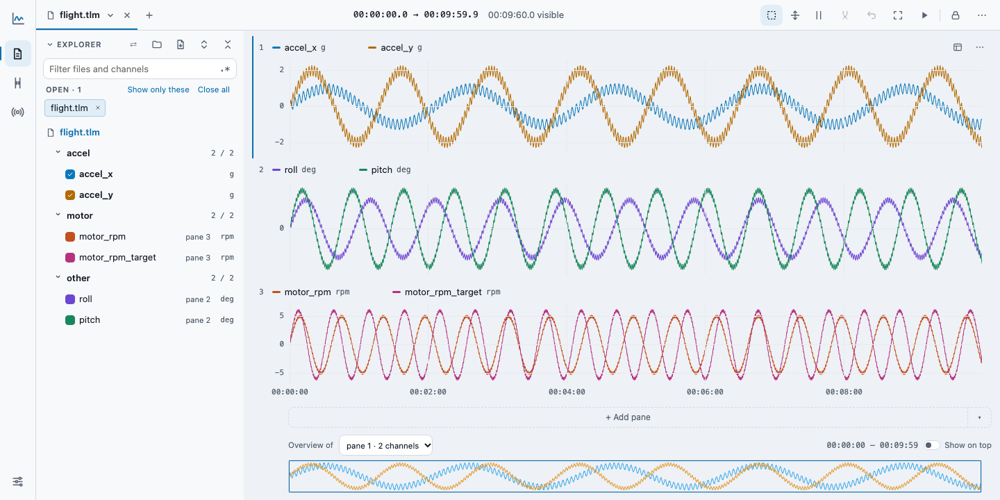
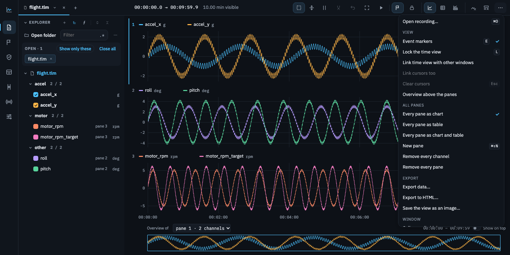
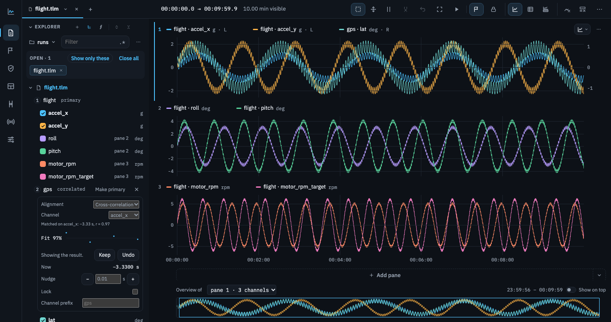
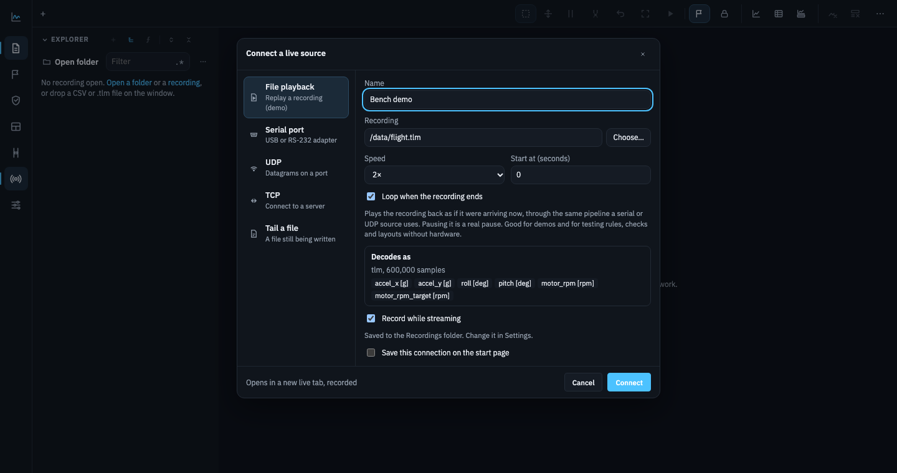
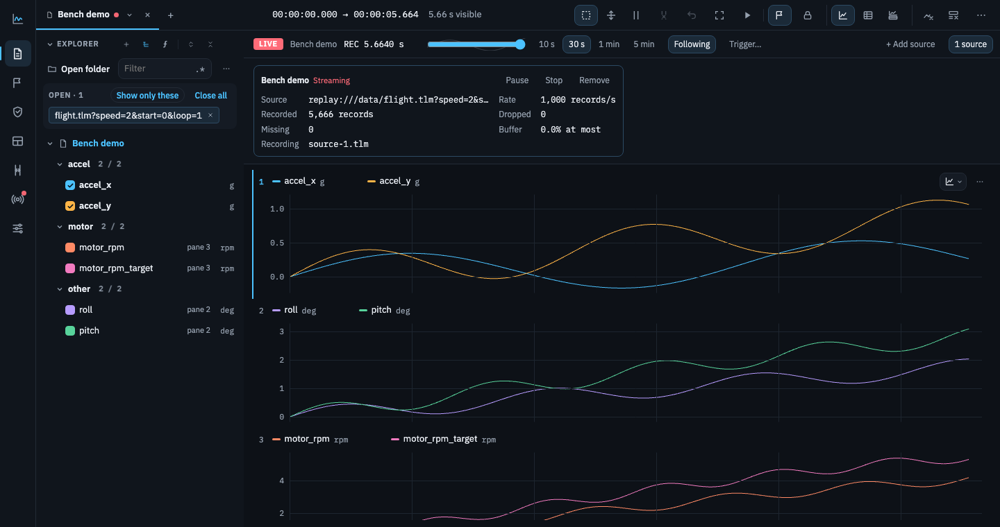

# TelemetryBench

**Open a 10 GB recording and see all of it in under a tenth of a second, with every spike still on screen.**

TelemetryBench (tlmbench) is a desktop workbench for engineers who plot, inspect and check telemetry from rigs,
vehicles and test benches. Pan and zoom over billions of samples at 60 fps, read exact values at any instant, and
run the same views, rules and checks from a command line in CI. It never writes next to your data: everything it
learns about a file lives in its own cache, so a read-only network share works as well as a local disk.



| Cursors and Measure | Light theme | The ⋯ menu |
| --- | --- | --- |
|  |  |  |

| Two files in one tab | Connect a live source |
| --- | --- |
|  |  |

| A live tab |
| --- |
|  |

## Why it's fast, and why you can trust what it draws

- **A min/max pyramid per channel.** A recording is read once, at disk speed, into summaries of 256, 1,024,
  4,096… samples (11% on top of the raw data), cached outside the data folder. Any view, from the whole file down to
  single samples, then reads a few thousand summaries instead of millions of samples.
- **Pixel-exact, not approximate.** Each pixel column is drawn from its first, last, minimum and maximum samples
  (M4). Answers from the pyramid are point-for-point identical to reducing every raw sample, and property tests check
  that against brute force. No spike is hidden at any zoom.
- **Coarse first, exact a moment later.** On a cold file the first frame comes from whole summaries alone, labelled
  "coarse". It still shows every extreme, and the exact view replaces it a moment later.
- **Gaps are honest.** Time jumps longer than a channel's gap factor × its median interval break the line, and
  missing samples are gaps, never interpolated.
- **One core everywhere.** The Rust core behind the app also powers the `tlmbench` CLI (and, in v1, Python
  bindings), so the numbers in a CI report are the numbers on screen.

## Measured (MacBook Air M1, 8 GB)

| | |
| --- | --- |
| Reopen a 10 GB, 20-channel recording, cache cold in memory | whole view drawn in **70 ms**, exact in 1.3 s |
| Pan and zoom over 20 traces of 125M samples each | 60 fps, 1 of 1,800 frames missed; zoomed views of all 20 in 4.4 ms (p95) |
| First-ever open of that file | axes and progress in 62 ms, summaries built in 9.9 s (disk read: 9.5 s) |
| Whole-file view of 100M samples, warm | 0.31 ms in the core (21 ms without the pyramid) |
| CSV ingest | 2.4 GB in 3 s (about 800 MB/s), reopened in 0.01 s |
| Live: 4M samples/s over TCP (4 × 1 MHz, 32 × 125 kHz), 60 s each | every record recorded, none dropped; 3.7–6.5% of a core |
| A live tab following that stream (10 s window) | 0 and 3 of 3,540 frames missed, views in under 20 ms (p95) |

These are the project's own gates: `just gate` (Phase 1), `just gate2` (Phase 2) and `just gate3 core` / `just gate3
app` (Phase 3) reproduce them. (Phase 2's first paint measured 112–146 ms in the latest runs.)

## What works today

- **The app** (Tauri, Svelte, WebGL2), with the prototype's UI: an icon rail, Explorer (open a folder; folder → file
  → channel), a tab per open file (restored at launch), a stack of panes in rows and columns (split, duplicate, close
  with Undo, drag), an overview strip, Box zoom, Pan and Cursors with Back and Fit, values at the pointer, cursors A
  and B with Measure (values, Δt, Δy, exact min, max, mean and standard deviation), a gap factor per channel, Settings,
  and Play (a playhead the view follows, speed, window, A–B loop). Files being summarized fill in left to right.
- **Live:** connect a serial port, TCP, UDP, a growing CSV or `.tlm` file, or replay a recording as if it were arriving
  now (file playback, for demos and for testing rules without hardware). A live tab follows now (window presets, scrub
  back with the session drawn behind the scrubber, Jump to live), shows each source's health and warns when samples are
  dropped, and can pause, stop and add sources. A trigger on any channel or expression freezes a window around a
  crossing and marks it as an event; rules and checks run on the live file every couple of seconds; derived
  channels follow it. The session records to a folder you choose (never beside the data) and reopens like any file.
- **Several files:** put recordings on one timeline in one tab (Add to tab, Open together, or Compare runs for two
  runs with starts aligned and a pane per shared channel). Each file takes a numbered slot (`accel_x·2`, shown as
  `gps · lat`); Make primary and Channel prefix… are on a file's right-click menu. The Alignment section lines a file up
  with the primary by Align starts, Same clock, an Offset, Sync points (from cursors A and B), Event matching, windowed
  Cross-correlation (offset and clock drift) or a time channel both files record; it shows the fit, lets you Keep or
  Undo a result, nudge it and lock it. Nothing is rewritten: each file keeps its own pyramid and a time map is applied
  when a view is asked for. Derived channels can read the other files' channels (`"Close·2"`), tables show another
  file's columns held between its samples, and a session brings the files back with their alignment.
- **Windows:** several windows on one core. Move a tab to a new window from its menu, or drag it out of the strip (or
  onto another window's strip); a live source can show in two windows from one ingest; Link time view (and cursors)
  keeps windows on one flight in step. Settings apply to every window at once, while sidebar layout is per window, and
  the windows come back on the next start. (The standalone daemon and browser tabs are still to come.)
- **Analysis:** tables with sort and filter, XY plots, Gauges and widgets of your own, derived channels (expressions
  and recipes), channel display, limits and value labels, events, and rules and checks (also `tlmbench check` in CI).
- **Formats:** CSV (delimiter, units and time column detected) and Parquet (typed columns), each converted once to
  a column cache; fixed-width binary records described by a TOML descriptor, including the self-describing `.tlm`
  reference format; and packet files (sync word, length, checksum, zstd/lz4/gzip payloads) by the same descriptor,
  indexed once and decompressed on demand (the CLI for now; the app gets them with the descriptor form).
- **The CLI:**

  ```
  tlmbench info flight.tlm                         # channels, units, time base, gaps
  tlmbench cache build flight.tlm                  # build the summaries ahead of time (resumes if interrupted)
  tlmbench query view flight.tlm -c volts --width 1500 --from 250 --until 460
  tlmbench query values flight.tlm --at 7.5        # each channel's sample nearest a time
  tlmbench query stats flight.tlm -c amps          # exact stats over a span
  tlmbench record tcp://10.0.0.2:9000 --descriptor frames.toml   # record a live source into a session
  tlmbench record file:///logs/run.csv             # follow a growing CSV (only read)
  tlmbench record replay://flight.tlm?speed=10    # replay a recording through the live path (a demo, no hardware)
  tlmbench check runs/ --set acceptance.toml       # exit 0 all pass, 1 a check failed, 2 couldn't run, 3 configuration
  tlmbench convert flight.tlm --to parquet --out out/ -c "motor_*,battery_v"   # also csv, arrow, hdf5, mat
  ```

- **Read-only by design,** tested in CI against a read-only mount: nothing is written beside the data.

## Where it's going

v1 is the whole design in [`docs/design.md`](docs/design.md), built in five gated phases:

| Phase | | Gate |
| --- | --- | --- |
| 1. Core loop | ✓ done | 100M points at 60 fps |
| 2. Scale | ✓ gate passes | 10 GB first paint under 1 s |
| 3. Live | ✓ gate passes | 4M samples/s with no drops |
| 4. Formats + polish | ✓ done | formats complete |
| 5. Workbench | in progress: derived channels, events, rules and checks, widgets, live, several files with alignment and the shared `.tlmbench/` configuration are in; multiple windows (the standalone daemon is next), plugins, Python, static HTML export | a folder check and an HTML export of a 2 h flight |

[`docs/roadmap.md`](docs/roadmap.md) orders the remaining steps and [`docs/feature-matrix.md`](docs/feature-matrix.md) shows
each feature in the design, the prototype and the app.

The whole UI already exists as a working prototype: [`prototype/plotter.html`](prototype/plotter.html), one file with
no build step and data synthesized in the page. It is the spec the app's UI is ported from.

## Repository

```
app/            the desktop app: Tauri shell (src-tauri) and the TypeScript + WebGL2 UI (ui)
crates/core     time base, M4, the pyramid (build, exact queries, stats), gap index, wire format
crates/decode   CSV column cache, format descriptors, the .tlm reference format (fuzzed)
crates/store    the cache: pyramid files, resumable builds, eviction, the chunk cache, view batches; derived
                channels, checks, events, widgets, live files and triggers
crates/expr     expressions: parser, evaluator, recipes, filters, the FFT
crates/live     live sources (serial, TCP, UDP, tail, file playback), the ring buffer and session recording
crates/export   data export writers
cli/            the tlmbench command line
tools/          gen (deterministic synthetic recordings), icons, winid (screenshots)
prototype/      the UI prototype and its Playwright suite
docs/           the design doc, development guide, follow-ups
examples/       shared configuration in the formats the app writes (.tlmbench/)
ci/             CI image, pinned versions, setup, read-only and eviction scripts
```

## Getting started

Development is native on the Mac; Linux and Windows build in CI. Full setup is in
[`docs/development.md`](docs/development.md).

```
brew bundle && ci/setup.sh     # pinned toolchains; then open a new shell
just lint test                 # rustfmt, clippy, unit and property tests
just gen --samples 20M --channels 6 --format tlm   # a synthetic recording in ~/tlmbench-data
just app-dev ~/tlmbench-data/synth-20000000-6ch.tlm
just proto-test                # the prototype's browser tests
```

Shared configuration (check sets, recipes, layouts) lives in a folder's `.tlmbench/`, one small file per object and
ready for git: see [`examples/README.md`](examples/README.md).
