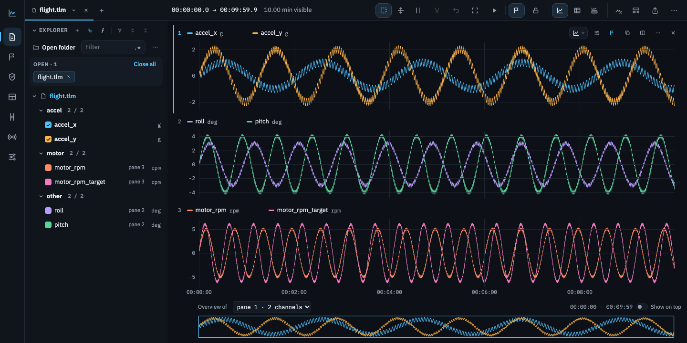
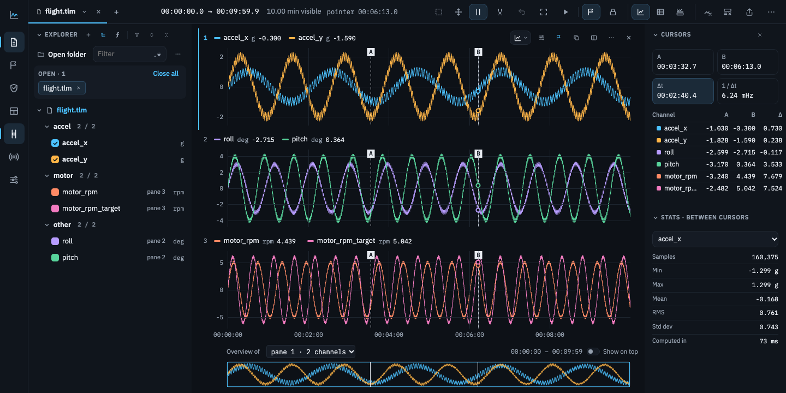
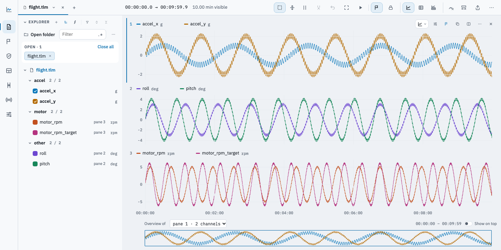
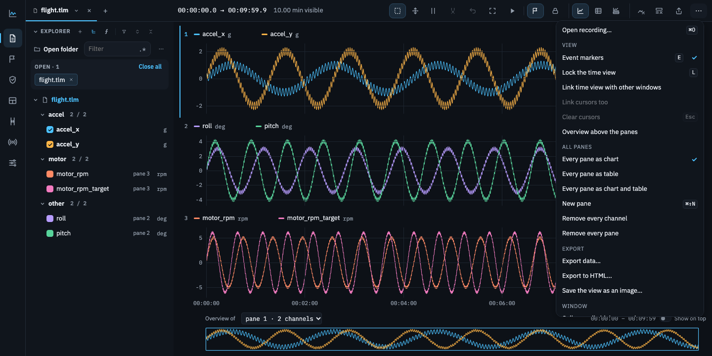
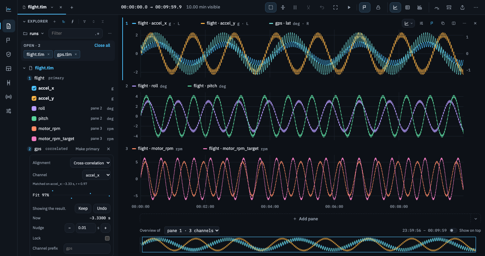
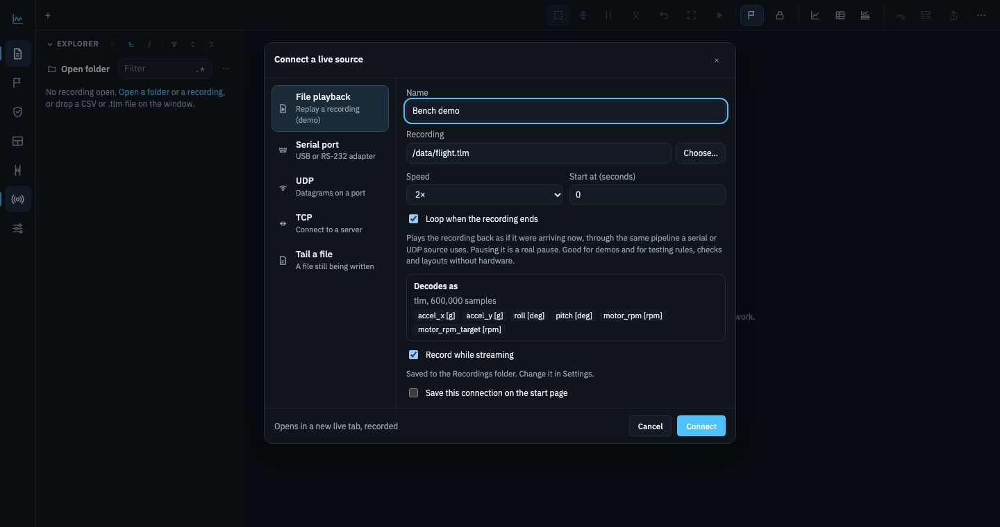
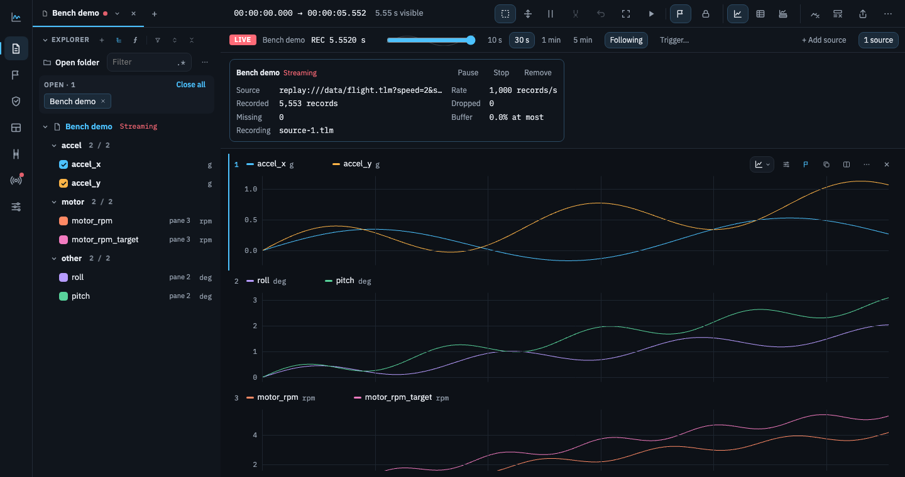
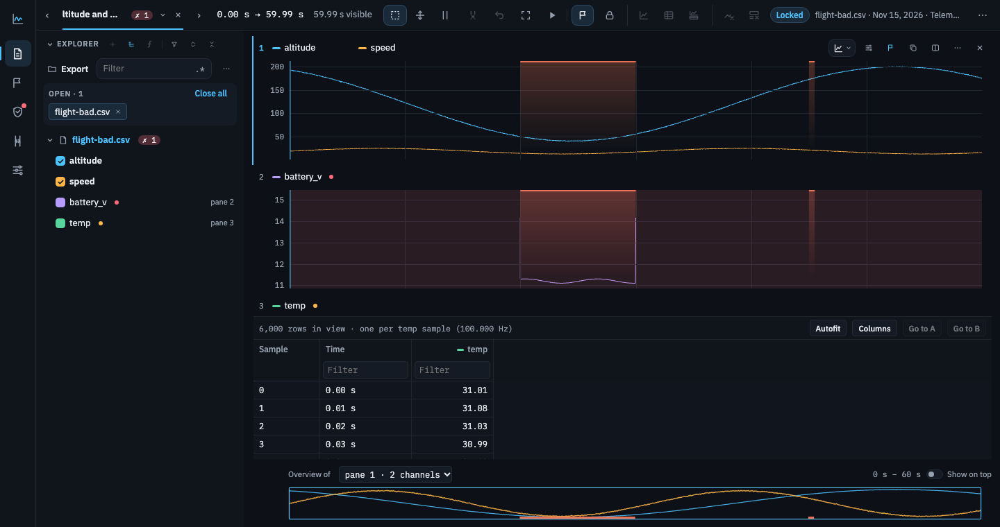
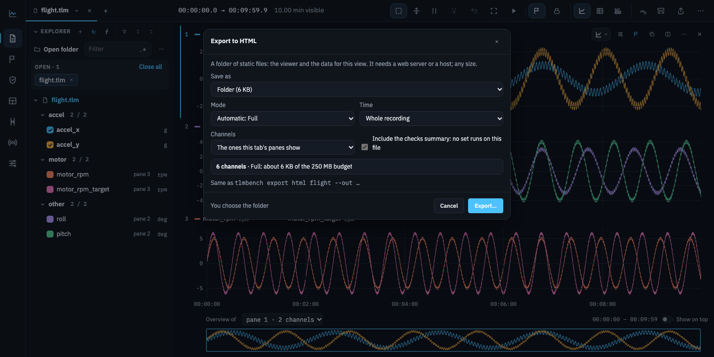
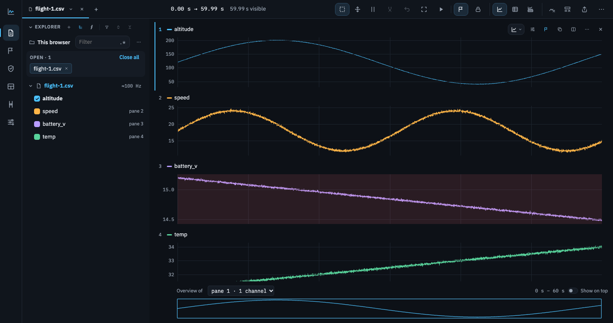

# TelemetryBench

**Open a 10 GB recording and see all of it in under a tenth of a second, with every spike still on screen.**

TelemetryBench (tlmbench) is a desktop workbench for engineers who plot, inspect and check telemetry from rigs,
vehicles and test benches. Pan and zoom over billions of samples at 60 fps, read exact values at any instant, and
run the same views, rules and checks from a command line in CI. It never writes next to your data: everything it
learns about a file lives in its own cache, so a read-only network share works as well as a local disk.

**[User Manual](https://rafyarvelo.github.io/tlmbench/manual/)** · [Try it in your browser](https://rafyarvelo.github.io/tlmbench/app/) · [A sample export](https://rafyarvelo.github.io/tlmbench/sample/) · [Install](docs/install.md) · [Developers guide](docs/developers/README.md)



| Cursors and Measure | Light theme | The ⋯ menu |
| --- | --- | --- |
|  |  |  |

| Two files in one tab | Connect a live source |
| --- | --- |
|  |  |

| A live tab |
| --- |
|  |

| An HTML export, from a static server | Export to HTML… |
| --- | --- |
|  |  |

| In a browser tab, no install |
| --- |
|  |

## Install

Download the app for your system from the [Releases page](https://github.com/rafyarvelo/tlmbench/releases): a `.dmg` for
macOS (Apple silicon and Intel), an installer, `.msi` or portable zip for Windows, a `.deb` or AppImage for Linux. The
command line comes with the app (Help › Install command-line tool…) and on its own for each OS; Python is
`pip install tlmbench`. v1 isn't notarised by Apple or signed for Windows yet, so the first open needs one extra click:
[`docs/install.md`](docs/install.md) says where, for each OS, and how to check a download.

## Why it's fast, and why you can trust what it draws

- **A min/max pyramid per channel.** A recording is read once, at disk speed, into summaries of 256, 1,024,
  4,096… samples (11% on top of the raw data), cached outside the data folder. Any view, from the whole file down to
  single samples, then reads a few thousand summaries instead of millions of samples.
- **Pixel-exact, not approximate.** Each pixel column is drawn from its first, last, minimum and maximum samples
  (M4). Answers from the pyramid are point-for-point identical to reducing every raw sample, and property tests check
  that against brute force. No spike is hidden at any zoom.
- **Coarse first, exact a moment later.** On a cold file the first frame comes from whole summaries alone, labelled
  "coarse". It still shows every extreme, and the exact view replaces it a moment later.
- **Gaps are honest.** Time jumps longer than a channel's gap factor × its median interval break the line, and
  missing samples are gaps, never interpolated.
- **One core everywhere.** The Rust core behind the app also powers the `tlmbench` CLI, the Python package, the
  HTML export's viewer (compiled to WASM) and browser-only mode, so the numbers in a CI report are the numbers on
  screen.

## Measured (MacBook Air M1, 8 GB)

| | |
| --- | --- |
| Reopen a 10 GB, 20-channel recording, cache cold in memory | whole view drawn in **70 ms**, exact in 1.3 s |
| Pan and zoom over 20 traces of 125M samples each | 60 fps, 1 of 1,800 frames missed; zoomed views of all 20 in 4.4 ms (p95) |
| First-ever open of that file | axes and progress in 62 ms, summaries built in 9.9 s (disk read: 9.5 s) |
| Whole-file view of 100M samples, warm | 0.31 ms in the core (21 ms without the pyramid) |
| CSV ingest | 2.4 GB in 3 s (about 800 MB/s), reopened in 0.01 s |
| Live: 4M samples/s over TCP (4 × 1 MHz, 32 × 125 kHz), 60 s each | every record recorded, none dropped; 3.7–6.5% of a core |
| A live tab following that stream (10 s window) | 0 and 3 of 3,540 frames missed, views in under 20 ms (p95) |

These are the project's own gates (last run Nov 1 to 9, 2026; they are re-run on the release build before v1): `just gate`,
`just gate2` and `just gate3 core` / `just gate3 app` reproduce them. An HTML export of a 2 h, 20-channel flight is 117.6 MB
and draws its first chart in 0.2 s from a local static host (`just gate5`).

## What it does

- **The app** (Tauri, Svelte, WebGL2): an icon rail, the Explorer (a folder's recordings, folder → file → channel), a tab per
  open file, a stack of panes in rows and columns (split, duplicate, close with Undo, drag), an overview strip, Box zoom,
  Pan and Cursors with Back and Fit, values at the pointer, cursors A and B with Measure (Δt, Δy, exact min, max, mean and
  standard deviation), Play (a playhead, speed, an A–B loop), a native menu bar, ⌘Z undo, and settings that are all kept.
- **Formats:** CSV (delimiter, units and time column detected), Parquet, fixed-width binary records and packet files
  (sync word, length, checksum, zstd, LZ4 or gzip payloads) described by a TOML descriptor (with a form for a file nothing
  reads yet), the self-describing `.tlm` reference format, and decoder plugins. Each is read once into the app's cache.
- **Analysis:** tables with sort and filter, XY plots, Gauges and widgets of your own, derived channels (expressions and
  recipes), channel display, limits and value labels, events, and rules and checks with reports (also `tlmbench check`
  in CI).
- **Several files:** recordings on one timeline in one tab, each in a numbered slot (`accel_x·2`, shown as `gps · lat`),
  lined up by Align starts, Same clock, an offset, sync points, event matching, cross-correlation, a time channel or an
  alignment plugin. Nothing is rewritten: a time map is applied when a view is asked for.
- **Live:** a serial port, TCP, UDP, a growing CSV or `.tlm`, or a recording replayed as if it were arriving now. Triggers
  on any channel or expression, rules and checks on the live file, several sources in one tab, recording to a folder you
  choose (never beside the data).
- **Windows:** several windows on one core; drag a tab out to its own window; link the time view across windows. Browser
  access serves the same UI to browser tabs on this computer.
- **Sharing:** a folder's `.tlmbench/` holds layouts, check sets, recipes, events, widgets and decoders as small files ready
  for git; Share… writes only what changed, and a read-only folder offers Export… instead.
- **Plugins:** WASM components in a sandbox (no files, network or clock; a time and memory limit per call), or native
  libraries that stay off until you turn them on. `plugins/template-decoder` and `plugins/template-estimator` are crates to
  start from.
- **Export to HTML:** a folder (any size, from any static host) or one HTML file (opens from anywhere), with raw samples
  when they fit and exact summaries when they don't. The viewer is the app's own UI over the core compiled to WASM; it opens
  Locked, and Unlock lets a reader rearrange it without changing the export.
- **In a browser, no install:** `app/browser/dist` is the same UI with the core in WASM. Open CSV, Parquet or `.tlm` files in
  the tab; nothing leaves the machine and the files come back after a reload.
- **The CLI and Python** over the same core and cache:

  ```
  tlmbench info flight.tlm                         # channels, units, time base, gaps
  tlmbench query view flight.tlm -c volts --width 1500 --from 250 --until 460
  tlmbench query stats flight.tlm -c amps          # exact stats over a span
  tlmbench record tcp://10.0.0.2:9000 --descriptor frames.toml   # record a live source
  tlmbench check runs/ --set acceptance.toml       # exit 0 all pass, 1 a check failed, 2 couldn't run, 3 configuration
  tlmbench convert flight.tlm --to parquet --out out/ -c "motor_*,battery_v"   # also csv, arrow, hdf5, mat
  tlmbench export html flight.tlm --layout "Flight review" --checks "Flight acceptance" --out site/
  ```

  ```python
  import tlmbench
  rec = tlmbench.open("flight.tlm")
  rec.read(["volts"])        # NumPy; rec.to_arrow(), rec.view(), rec.stats(), rec.check(), rec.export_html()
  ```

  The app never runs Python; scripts run outside it.
- **Read-only by design,** tested in CI against a read-only mount: nothing is written beside the data. When WebGL2 isn't
  there, the traces draw with Canvas 2D.

## Repository

```
app/            the desktop app: Tauri shell (src-tauri), the Svelte + WebGL2 UI (ui), the HTML export's viewer
                (viewer) and browser-only mode (browser)
crates/core     time base, M4, the pyramid (build, exact queries, stats), gap index, wire format
crates/decode   CSV and Parquet column caches, format descriptors, packets, the .tlm reference format (fuzzed)
crates/store    the cache: pyramid files, resumable builds, eviction, views; derived channels, checks, events,
                widgets, several files and alignment, shared configuration, live files and triggers
crates/expr     expressions: parser, evaluator, recipes, filters, the FFT
crates/live     live sources (serial, TCP, UDP, tail, file playback), the ring buffer and session recording
crates/plugin   WASM (wasmtime, WIT) and native plugins
crates/export   data export writers and the HTML export
crates/web      the core compiled to WASM for the viewer and browser-only mode (web-parquet: its Parquet reader)
cli/            the tlmbench command line
python/         the tlmbench Python package (pyo3, maturin)
plugins/        plugin templates and test plugins
tools/          gen (synthetic recordings), testdata (the owner's test files), icons, winid (screenshots)
prototype/      the UI prototype and its Playwright suite
docs/           design, development guide, release plan and ledger (docs/README.md lists them)
examples/       shared configuration in the formats the app writes (.tlmbench/)
ci/             CI image, pinned versions, setup, gates, read-only and ledger checks
```

## Building from source

Development is native on the Mac; Linux and Windows build in CI. Full setup is in
[the developers guide](docs/developers/README.md).

```
brew bundle && ci/setup.sh     # pinned toolchains; then open a new shell
just lint test                 # rustfmt, clippy, unit and property tests
just gen --samples 20M --channels 6 --format tlm   # a synthetic recording in ~/tlmbench-data
just app-dev ~/tlmbench-data/synth-20000000-6ch.tlm
just proto-test                # the prototype's browser tests
node app/ui/tests/shots.js     # the screenshots in this README (after npm run build in app/ui)
```

Shared configuration (check sets, recipes, layouts) lives in a folder's `.tlmbench/`, one small file per object and
ready for git: see [`examples/README.md`](examples/README.md).

## Reporting a problem, contributing

Bugs and ideas: [GitHub issues](https://github.com/rafyarvelo/tlmbench/issues). Security problems go privately: see
[SECURITY.md](SECURITY.md). How to build, test and send a change: [CONTRIBUTING.md](CONTRIBUTING.md).

## Licence

The code is licensed under the [Apache License 2.0](LICENSE); the manual and screenshots under
[CC BY 4.0](https://creativecommons.org/licenses/by/4.0/).
