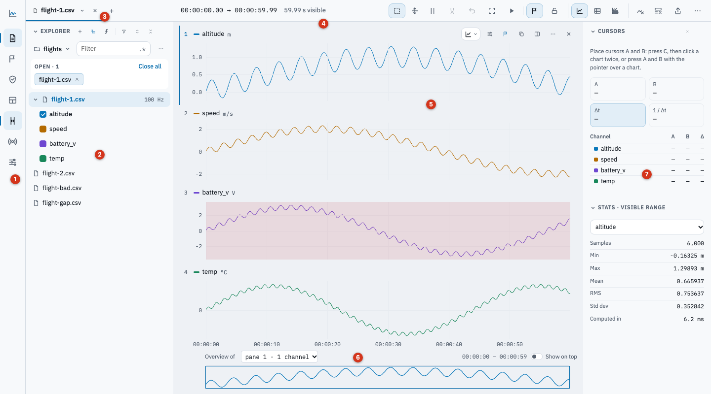
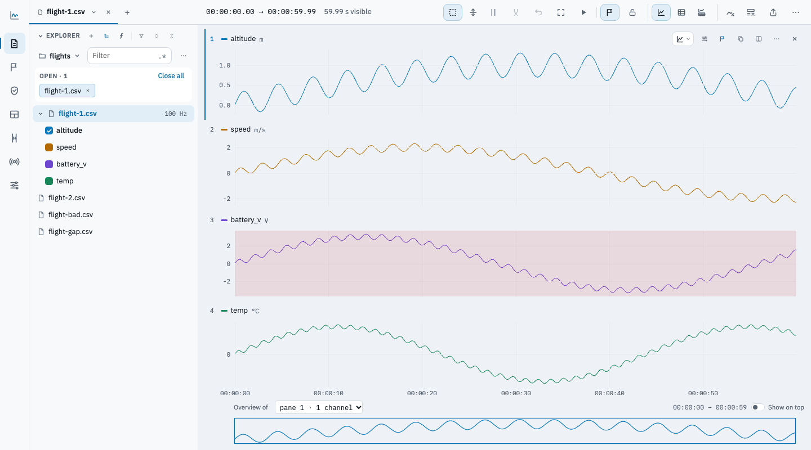
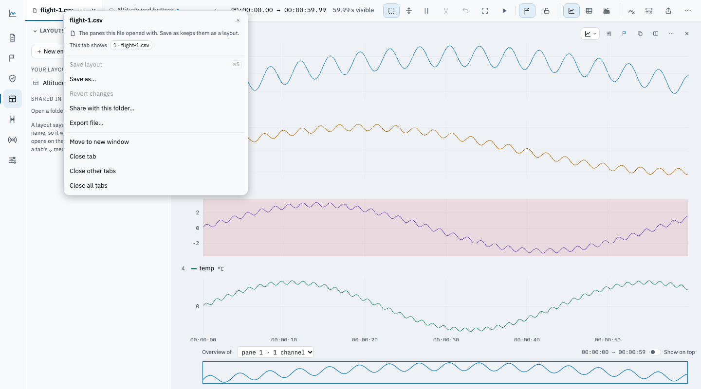
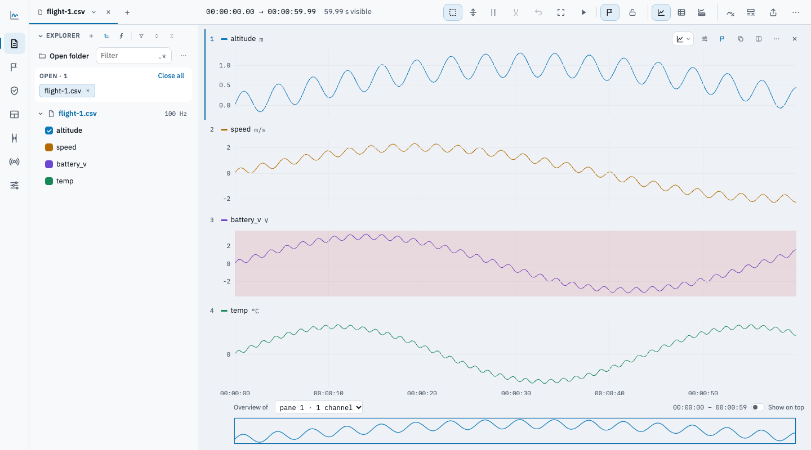
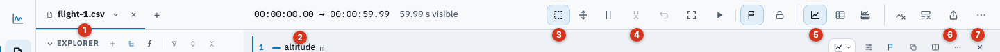

# The window

This chapter names the parts of the window and what each does: the icon rail, Explorer, tabs, panes, the overview strip, the top bar and the menu bar. It ends with two settings that change how calm or fixed the window is, Quiet interface and Lock.

## The icon rail

The narrow strip on the left. Click an icon to open its view in the left sidebar; click it again to hide the sidebar.

| Icon | Opens |
| --- | --- |
| Logo | **Start page**: open a folder or recording, or a recent one |
| **Explorer** (⌘B / Ctrl+B) | The open file and its channels |
| **Events** | Markers and ranges you add to the recording |
| **Rules & checks** | What should hold in a recording; a dot shows when the file in front has failures or warnings |
| **Layouts** | Your saved layouts and the ones shared in this folder |
| **Measure** (⌥⌘B / Ctrl+Alt+B) | Values at the cursors and stats between them, docked on the right |
| **Live** | The live tab, or the Connect dialog |
| **Settings** (⌘, / Ctrl+,) | Everything configurable. It is saved as you change it |

Panels can move: drag a panel's title to reorder it or put it on the other side, or use its swap button. **Reset UI layout** in Settings undoes that. Window › **Collapse or expand the sidebar panels** folds them all at once. **Focus mode** (⌘. / Ctrl+.) hides the sidebars and toolbar; **Exit focus** or Esc brings them back.

In a browser tab (browser-only mode) Events, Rules & checks, Layouts and Live are not there.

## Explorer

Explorer is a tree: **folder → file → channel**.

- **Folder.** The button at the top of Explorer (**Open folder** until one is open, then the folder's name) opens a menu: **Open folder…**, **Refresh**, **Open recording…**, **Import all N files…**, **Recipes and profiles…**, **Share…**, expand and collapse all, **Remove the folder from Explorer**, **Close all files**. New files show by themselves; on a network share, **Refresh** finds them.
- **Files.** Hover a file for **Open** and **Only this** (opens it and closes the other tabs). Right-click a file for more: **Open with layout ▸**, **Import settings…**, **Format descriptor…**, **Compare runs**, **Add to this tab**, **Open with its default app**, **Close this file**.
- **Channels.** An open file expands to its channels, grouped by category. The box beside a channel plots it in the selected pane. Select several channels (Shift-click for a range, Ctrl/⌘-click to add) and a bar offers **Add to pane N**, **Chart**, **Table**, **Derive…** and **Remove**. Drag a channel onto a pane to add it.
- **Filter.** Type in the filter box to narrow files and channels. The **.\*** button makes it a regular expression.
- **Title row.** Buttons add every shown channel to the selected pane, switch **Show categories** between a flat list and groups, make a **New derived channel**, list **only open files**, and expand or collapse everything. The **Explorer actions** menu (⋯) adds **Add all N channels to pane N**, **Open them in a new chart** or **table**, and **Show files that can't be opened**.

Select several files and the bar offers **Open** (a tab each), **Open together** (one tab, one timeline), **Compare runs** (for two files) and **Close**.

## Tabs

The tab strip sits at the top. Every open thing is a tab:

- A **file tab** (file icon) shows one file, or several on one timeline, with the panes it opened with.
- A **layout tab** (layout icon) is a saved layout applied to a file. Its name is the layout's.
- A **live tab** has a dot while it is streaming.

Click a tab to bring it forward, middle-click or click its **×** to close it, drag it to reorder. Ctrl+PageUp and Ctrl+PageDown switch tabs; add Shift to move the tab. Drag a tab out of the window to move it to a new window. When tabs do not fit, ‹ › scroll the strip.

A dot on a tab means unsaved changes: **Save layout** (⌘S / Ctrl+S) keeps them.

**The + button** opens a menu: **Empty layout…** and your saved layouts. Choose a layout to open it in a new tab.

**The tab menu** (the ⌄ on a tab, or right-click it):

- **Save layout**, **Save as…** (turns a file tab into a layout tab, or copies a layout), **Revert changes**.
- **Share with this folder…** writes the layout to the folder's `.tlmbench/views/`. If the folder is read-only the item becomes **Export file…**, which writes it where you choose.
- **Export file…**, **Rename…**, **Delete layout**.
- **Move to new window**, **Close tab**, **Close other tabs**, **Close all tabs**.

A layout shared by someone else is read-only: **Save as…** makes your own copy.

## Panes

The area under the top bar is a stack of panes sharing one time axis. Panes are arranged in **rows**; a row holds up to four **columns** side by side. The stack scrolls when the panes do not fit.

**Add a pane.** Press ⇧⌘N / Ctrl+Shift+N (**New pane**), click the **+** between two rows, or choose **Add a pane below** in a pane's menu.

**Select a pane** by clicking it. Channels you click in Explorer go to the selected pane.

**Split.** In the pane's menu, **Split right** adds an empty pane beside it (up to four per row) and **Split down** adds one under it. To pick a side, drag a channel onto the left or right edge of a pane.

**Duplicate.** **Duplicate** (⌘D / Ctrl+D) copies the pane below it with its channels, view, sort and filters. **Duplicate beside** (⇧⌘D / Ctrl+Shift+D, or Shift-click the duplicate button) puts the copy next to it. With two files in a tab, **Duplicate for file N** copies the pane's channels from another file.

**Close.** **Close pane** closes one; **Close others** and **Close panes below** close several. A note appears at the bottom with **Undo** for 12 seconds. Undo is also ⌘Z / Ctrl+Z, and redo is ⇧⌘Z / Ctrl+Shift+Z (Ctrl+Y on Windows and Linux). One history covers panes, their channels and views. **Remove every channel** and **Remove every pane** (Pane menu) also have Undo.

**Drag.**
- Drag a pane by its number to move it. Over another pane, the outer edges (left and right) put it beside, the top and bottom parts start a new row, and the middle merges the channels. Hold Ctrl (Windows and Linux) or ⌥ or ⌘ (Mac) while dropping to copy instead.
- Drag a channel chip to another pane to move it, with the same key to copy.
- Drag the grip at the bottom of a pane to change its height; double-click it to reset.

**Rename.** Double-click the pane's number, or choose **Rename pane…**.

### The pane header

The header shows the pane's number, an optional name, and one chip per channel (colour, name, unit, and the value at the pointer). A chip's **×** takes the channel out of the pane; click the chip itself for its display settings. If chips do not fit, **+N** lists them all with their values.

On the right of the header:

- A **view** button. Click it to choose how the pane shows its channels: **Chart**, **Table**, **Chart and table**, **Chart and values**, **Values**, **Gauges**, **XY plot**, **Spectrum**, and **Checks** (not in a browser tab).
- A **coarse** label when the pane is drawn from summaries (see chapter 4).
- On hover or selection, **⋯** (also right-click on the header).

### The ⋯ menu

For charts: **Event markers in this pane** and **Axis and scale…**. Then **Rename pane…**, **Close others**, **Close panes below**, **Close pane**, **Duplicate**, **Duplicate beside**, **Duplicate for file N**, **Split right**, **Split down**, **Add a pane below**. On a wide window some of these also show as buttons in the header.

## The overview strip

Under the panes (or above them) is the overview: the whole recording as a min/max band, with the part in view marked. A live tab has no overview; its strip has a scrubber instead.

- The drop-down **Overview of** picks what it draws: the selected pane's channels, or one channel. The recording's time range is at the right.
- **Show on top** moves it above the panes. The same switch is **Overview above the panes** in the View menu.
- What a drag does follows the mouse mode. In **Box zoom**, drag out a new view; a click centres the view there. In **Pan**, drag the window, or click to move it there. In **Cursors**, click to place A and B. The wheel zooms.

## The top bar

From left to right:

1. The tabs and **+**, then your pinned layouts and recipes, if any (right-click a pin to unpin).
2. The **time range** in view, its span, and the time under the pointer. Click the range to choose how times read (chapter 4).
3. **Mouse mode**: **Box zoom** (B), **Pan** (P), **Cursors** (C).
4. **Clear cursors** (Esc), **Back** (⌥← / Alt+←), **Fit** (F), **Play back** (Space), **Event markers** (E), **Lock** (L).
5. On a window at least 1,200 px wide, **Charts / Tables / Both** set every pane's view at once. At 1,300 px, **Remove every channel** and **Remove every pane** appear too.
6. **Export**: to HTML, data files or an image.
7. **⋯ More**: **Open recording…**, **Link time view with other windows** and **Link cursors too**, **Overview above the panes**, the all-panes views, **Collapse or expand the sidebar panels**, **Switch theme** (T), **Focus mode**, **Show performance details**, **Settings…**. On a narrower window, Clear, Back, Fit, Play and Lock move into this menu.

## The menu bar

The desktop app has a native menu bar (a browser tab and an HTML export do not). Each item and its shortcut:

| Menu | Items |
| --- | --- |
| File | **Open recording…** (⌘O / Ctrl+O), **Open folder…** (⇧⌘O / Ctrl+Shift+O), **Save layout** (⌘S / Ctrl+S), **Export data…**, **Export to HTML…**, **Save the view as an image…**, **Close tab** |
| Edit | **Undo** (⌘Z / Ctrl+Z), **Redo** (⇧⌘Z / Ctrl+Shift+Z), **Clear cursors** (Esc) |
| View | **Back to the previous view** (Backspace), **Fit to the data** (F), **Zoom in** (+), **Zoom out** (−), **Event markers** (E), **Lock the time view** (L), **Overview above the panes**, **Switch theme** (T), **Settings…** (⌘, / Ctrl+,) |
| Pane | **New pane** (⇧⌘N / Ctrl+Shift+N), **Duplicate pane** (⌘D / Ctrl+D), **Duplicate pane beside** (⇧⌘D / Ctrl+Shift+D), **Remove every channel**, **Remove every pane** |
| Window | **Focus mode** (⌘. / Ctrl+.), **Collapse or expand the sidebar panels**, **Show performance details** |
| Help | **Show the tips again**, **Install command-line tool…** |

Single-key shortcuts (E, L, T, F, Esc, Backspace) do not work while you type in a text field.

**Show performance details** adds a status bar with the core's memory and CPU load and what the last view cost.

## Quiet interface

**Quiet interface** (Settings › Display) hides badges and readouts until they matter: the panes a channel is in, counts, chip values while you point at a plot, file numbers in the folder until you point at a file, and resize grips until you hover them. A pane's header keeps its view button and ⋯; close, split, duplicate, events and axis are in ⋯. It is off by default.

## Lock

**Lock** (L, or the padlock in the top bar) stops zoom, pan and Fit from changing the time view, so you cannot lose your place by accident. Cursors and Measure still work.

By default it also locks the layout: panes and their channels stay put, with no moving, adding, closing or resizing. Controls that would change them say "Unlock to change panes". Two settings under **Mouse** change this:

- **Also lock the layout**: turn off to lock only the time view.
- **Table sort and filter still work while locked**: on by default. Turn off and each table keeps its current sort and filters.

In an HTML export the same padlock appears, and the layout there always stays locked.

Next: [Opening data](03-opening-data.md).
