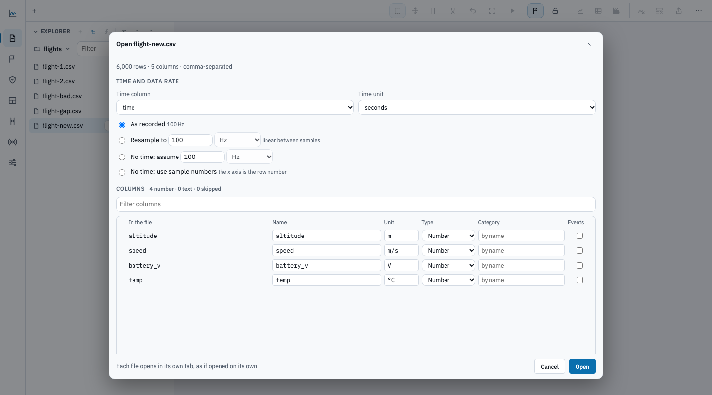
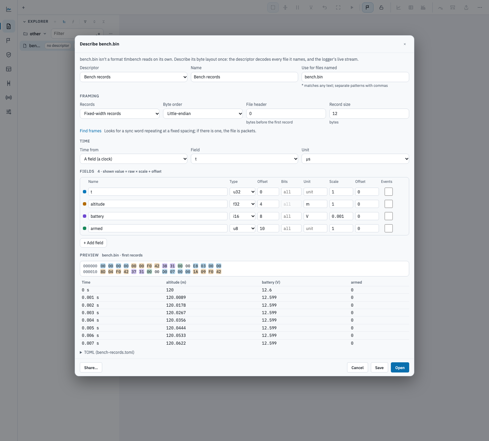

# Opening data

This chapter covers the file formats the app reads, how each one opens, and the ways to get a file or folder into the window: the menus, Explorer, a double-click in your file manager, and a drop. CSV files open through an import dialog the first time; binary files open through a descriptor, a small TOML file you can write by hand or build in a form. Chapter 6 covers aligning several files on one timeline.

## What opens

| Format | How it opens |
| --- | --- |
| CSV, TSV, `.txt` | The import dialog the first time a header is seen; then straight away |
| Parquet | Directly |
| `.tlm` | Directly: TelemetryBench's own self-describing format |
| Fixed-width binary and packet files | Through a descriptor (TOML) |
| Anything else a plugin decodes | Through a decoder plugin you added |

The app reads a file once into its cache and works from the cache after that. The file itself is never changed.

## CSV and TSV

When you open a CSV whose header has no saved settings, the import dialog (titled **Open** and the file's name, or **Import N files**) shows first. The top line says how many rows and columns it found and what separates them.

**Time and data rate.**
- **Time column**: pick the column that holds time, or **None**.
- **Time unit**: the unit of that column (greyed out when the rate below ignores it).
- **Data rate**, one of:
  - **As recorded**: use the times in the file.
  - **Resample to** a rate you type: linear between samples.
  - **No time: assume** a rate you type.
  - **No time: use sample numbers**: the x axis is the row number.

**Columns.** One row per column, with the name in the file, then your own **Name**, **Unit**, **Type** (**Number**, **Text** or **Skip**), **Category**, and **Events**. Leave Name blank to keep the file's name. A unit in brackets after a space in the header, like `[m/s]`, is taken as the unit. A text column opens as a channel that shows its texts, when it has 256 different texts or fewer. Tick **Events** to get one event at each change of that column's value. Use **Filter columns** to find one in a wide file.

**Also for files with this header.** Open this section to attach more to every file that has the same header: **Rules and checks that run on them**, **Derived channels they get**, the layout they open with, and the **Channel prefix in a tab with several files** (the file name, the name up to the first `_ - .` or space, part of the name by a regular expression, or custom text). The section is open already when you have set any of these.

**Where the files go.**
- **Each file in its own tab**
- **All files in one new tab**: the first is the primary; the others join on the same timeline.
- **Add to the current tab**
- **No tabs: just add them to Explorer**

**Opens as** sets the starting panes: starter charts, starter charts with tables, one table, one values pane, or nothing plotted. The default comes from Settings (**When a file opens**).

Click **Open** (or **Add to Explorer**). The choices are saved against the header, so any later file with the same columns opens without the dialog. If the header is close to one you have set up, the dialog offers **Apply** for a similar file's settings. When several files with the same header open together, one dialog covers all of them ("Applies to N files with this header").

To change the settings later, right-click the file in Explorer and choose **Import settings…**; the file reopens with the new ones. **Import all N files…** in the folder menu reads the settings for a whole folder in one go.

## Parquet and `.tlm`

These open directly. A `.tlm` file describes its own channels, units and time, so there is nothing to ask. Parquet columns become channels.

## Fixed-width binary and packet files

A binary log has no header the app can read, so you tell it the layout once, in a **descriptor**. When you open a binary file that no descriptor claims, the **Format descriptor** form opens by itself. You can also open it from Explorer: right-click the file and choose **Format descriptor…** (it is greyed out for CSV, TSV, Parquet and `.tlm`).

To describe a file:

1. Choose **New descriptor**, or pick one you already have from the **Descriptor** list.
2. Give it a **Name**, and in **Use for files named** the file names it covers. `*` matches any text; separate patterns with commas. Any file with a matching name then opens through this descriptor.
3. Under **Framing** choose **Fixed-width records** or **Packets**, the **Byte order**, the **File header** (bytes before the first record or packet) and the **Record size**. For packets, also give the **Sync word** (hex, like `A55A`), the **Packet header** size, a **Length field** (none, counting the payload, or counting the whole packet), the **Checksum** and the **Compression**. **Find frames** looks for a repeating sync word in the first bytes and fills in what it finds.
4. Under **Time** choose where time comes from: **A fixed sample rate**, **A field (a clock)** with its unit, **A counter that wraps** with its clock rate, or **Nothing: use sample numbers**.
5. Under **Fields**, add one row per value: **Name**, **Type**, byte **Offset**, **Bits** (a range, like `4-6`, for part of a byte), **Unit**, **Scale**, and a value **Offset**. The value shown is raw × scale + offset. Tick **Events** for one event at each change.
6. Watch the **Preview**: the first bytes in hex, coloured by field, and the first decoded rows. The form words each problem it finds in plain language, and for packets shows how many checksums are bad. The **TOML** block at the bottom is exactly what will be saved.
7. Click **Open** to save the descriptor and open the file through it. **Save** keeps it without opening. **Cancel** drops it.

A descriptor with several packet types opens each type as its own recording. The form shows them but does not edit them; edit the TOML file for that.

**Where descriptors live.** **Save** keeps a descriptor in the app's cache, for this computer. **Share…** writes it to the open folder's `.tlmbench/decoders/` as a `.toml` file, after asking, so everyone who opens the folder (or its git repository) decodes the files the same way. This is one of the few writes next to your data, and it only happens when you click it. Share is available when the file is inside the folder Explorer shows.

You can also write the TOML by hand. The same descriptor decodes recorded files and the live stream from the same logger.

## Plugins

For formats a descriptor cannot express, the app runs plugins. It never runs other programs or Python.

- **Decoder plugins** read a whole file format. A plugin is a single `.wasm` file in your plugins folder. Open the folder from **Settings › Plugins › Open folder**, drop the file in, and click **Rescan** (the app also reloads a plugin when it changes). Each plugin is listed with its version, its kind and the label **WASM, sandboxed**. A WASM plugin can reach no file or network. Files the plugin claims then open like any other.
- **Payload plugins** work inside a descriptor. The descriptor names one with `plugin = "name"` for a packet type, or for one field. The app does the framing, checksums and decompression, and the plugin turns the payload bytes into values. A browser tab does not run payload plugins yet; such a file opens in the app.
- **Native plugins** run at full speed with your rights. They stay off until you tick **On** beside each one in Settings, and only load from your own plugins folder.
- **Plugins shared in a folder** (in its `.tlmbench/`) wait for your OK: Settings shows "This folder has N plugins waiting for your OK" with a switch to trust them.

How to write a plugin is in the [developers guide](../developers/plugins.md).

## Opening from your computer

**Open recording…** (⌘O / Ctrl+O, **File** menu) shows a file picker for CSV, TSV, TXT, `.tlm` and Parquet files, and you can pick several. **Open folder…** (⇧⌘O / Ctrl+Shift+O) picks a folder and shows it in Explorer. Both are also on the start page.

**From the OS.** After installing, double-clicking a `.tlm` file opens it in TelemetryBench. CSV, TSV and Parquet files list TelemetryBench under **Open With** (it is an alternative, not the default). If the app is already running, the file opens in that window, on every system.

**Drop on the window.** Drag files or a folder from your file manager onto the window. A dropped folder does what **Open folder…** does (if you drop several folders, only the first opens, and a note says so). Dropped files open as **Open recording…** does, including the import dialog for a new CSV header.

**From Explorer.** Double-click a file, or select several and use the bar that appears. A file already open only comes to the front.

## Several files in a tab

A tab can show more than one file on one timeline. The first file is the **primary**: it keeps plain channel names and defines time zero. Channels of the others read as `prefix · channel`, with the prefix coming from the file name or your import settings.

- **Add to this tab**: right-click a file in Explorer. It joins the tab in front.
- **Open together**: select several files in Explorer, then click **Open together**. They open in one new tab.
- The import dialog's **Where the files go** does the same for files you are importing.
- **Make primary** (on a file's slot in Explorer, or its right-click menu) changes which file is first.

Each added file shows as a numbered slot in Explorer. **Alignment and channel prefix…** (its right-click menu) sets how its clock maps onto the primary's, and **Compare runs** opens two files aligned with a pane for each channel both have. [Chapter 6](06-several-files.md) covers alignment.

Next: [Reading data](04-reading-data.md).
