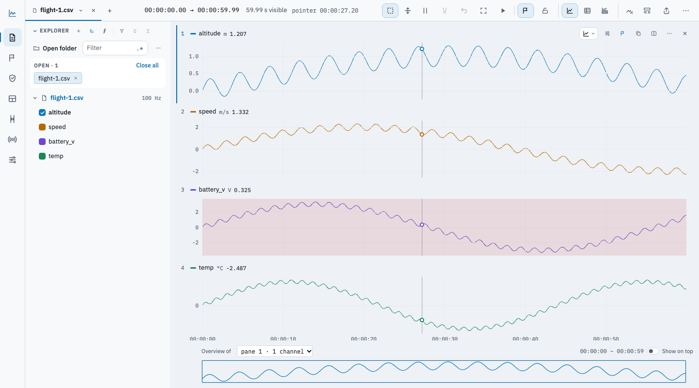
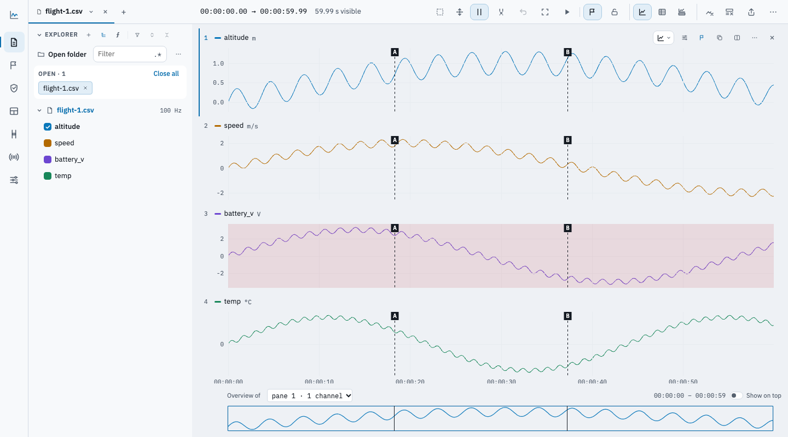
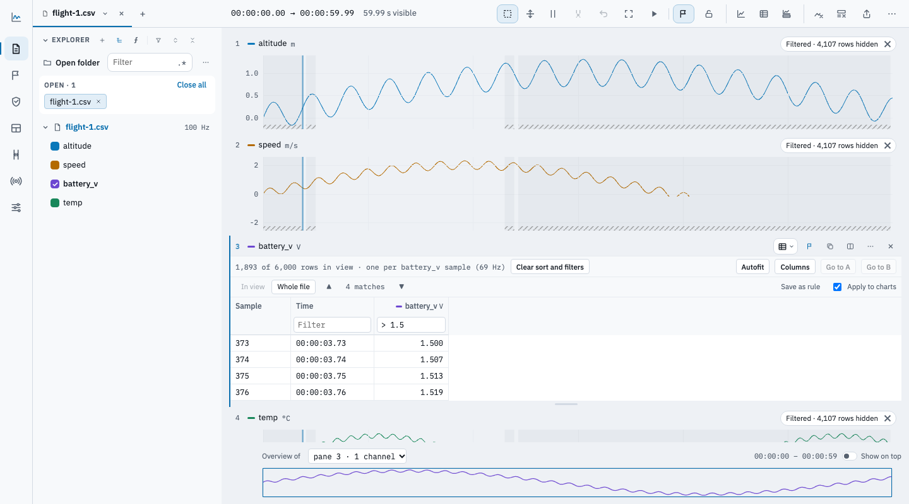
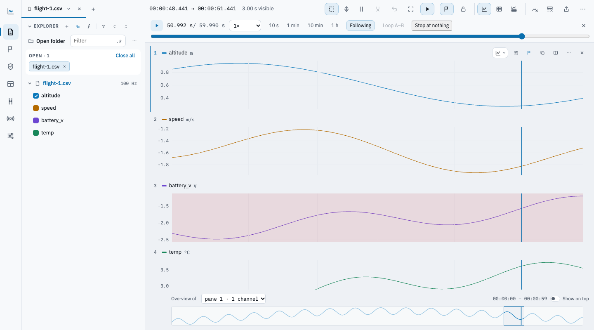

# Reading data

This chapter is about looking at a recording once it is open: moving around in time, reading exact values, placing cursors and measuring between them, working with tables and XY plots, choosing how times are written, and playing a recording back. It ends with what the "coarse" label and the hatching mean while a file is still being read.

## Moving around

The **mouse mode** in the top bar decides what a drag on a plot does. Switch with the buttons or the keys.

| Mode | Key | A drag on a plot |
| --- | --- | --- |
| **Box zoom** | B | Zooms into the range you drag across |
| **Pan** | P | Moves the view |
| **Cursors** | C | Places cursors A and B |

In every mode, Shift-drag or middle-drag pans, and a drag on a y-axis zooms that axis.

**Box zoom.** Drag across a plot; the view glides to that range. A drag narrower than 4 pixels does nothing and says "Drag wider to zoom".

**Pan.** Drag. The arrow keys ← → pan by 15% of the view.

**Zoom with the wheel.** Scroll over a plot to zoom at the pointer. A sideways scroll pans. Under **Settings › Mouse**, **Scroll wheel zooms the charts** can be turned off (the wheel then pans and Ctrl/⌘ + wheel zooms), and the zoom speed can be changed. **+** and **−** (or ↑ ↓) zoom about the centre.

**Zoom a y-axis.** Shift + scroll zooms the axis under the pointer, or every axis of the pane when the pointer is over the plot. Drag on an axis to zoom it, and double-click an axis to go back to fitting what is in view. **Axis and scale…** in a pane's ⋯ menu sets exact limits, labels, decimals and log scale.

**Back and Fit.**
- **Back** (⌥← / Alt+←, or Backspace) returns to the previous view. ⌥→ / Alt+→ goes forward again.
- **Fit** (F) shows the whole recording. A double-click on a plot does the same unless you turned off **Double-click fits the whole recording**.

**The overview.** The strip under the panes shows the whole recording. Drag in it as the mouse mode says (see chapter 2) to jump to any stretch.

**Lock** (L) stops zoom, pan and Fit from changing the time view. See chapter 2.

### End: following a live tab

In a live tab the view follows the newest data. The live strip shows **Following**. Drag its scrubber back through the session, or pan and zoom, and the view stays where you put it. The button then reads **Jump to live**, and so does the **End** key, which brings you back. Live sources have their own chapter.

## Values at the pointer

Point at a plot. A line follows the pointer across every pane, each channel chip in a pane's header shows its value at that time, and the top bar shows the time. The values come from the data, not from the drawing, so they stay exact when the plot is a summary of millions of samples.

If **Quiet interface** is on, chip values show only while you point at a plot.

For tiles instead of chips, switch a pane to **Values** or **Chart and values** from its view button. The tiles show the values at the pointer; with the pointer away, at cursor A, or at the end of the view. A line under the tiles says which. A tile shows a channel's warn and alarm level as a colour, and a click on it opens its limits.

When samples are far enough apart to see (about 6 pixels), the chart marks each one.

## Cursors A and B and Measure

**To place cursors**:

1. Press C (or click **Cursors** in the top bar).
2. Click a plot to place A, and click again to place B. A third click moves whichever is nearer.

Or, in any mode, point at a plot and press A or B. Over a table row, A and B place the cursor at that row's time. You can drag a cursor line to move it, and in the overview in **Cursors** mode a click places one there.

**Clear cursors** (Esc, or the button in the top bar) removes both. Cursors are saved with the session.

Open **Measure** from the rail (⌥⌘B / Ctrl+Alt+B). It has two panels, which you can collapse or move to the other side.

**Cursors panel.** Tiles for **A**, **B**, **Δt** and **1 / Δt** (the frequency of that interval), then a table with each plotted channel's value at A, at B, and the difference **Δ**. With no cursors it says how to place them.

**Stats panel.** The title says what it covers: **Stats · between cursors** with both cursors, or **Stats · visible range** without. Pick a channel in the drop-down. It shows **Samples**, **Min**, **Max**, **Mean**, **RMS**, **Std dev**, and for a channel with gaps, **Missing** and **Missing for**. The stats are exact over the range, computed in the core; while a file is still being read the panel says so and shows a percentage.

## Tables

Switch a pane to **Table** (or **Chart and table**) from its view button, or use **Charts / Tables / Both** in the top bar for every pane. A table lists the samples in the time view, one row per sample of its first channel. **Sample** and **Time** are always columns. Other channels' columns hold their last value between their own samples, dimmed where a cell repeats the one above.

**Select and sort.** By default a click on a column header selects the column (Shift-click for a range, Ctrl/⌘-click to add), and sorting is in the header's ▾ menu: **Sort ascending**, **Sort descending**, **Clear sort**. Turn on **Click a column header to sort** in Settings to sort with a click instead (click again to reverse, once more to clear, Shift-click to add a column). With columns selected, a bar offers **Chart**, **Table** (new panes with just those columns) and **Hide**. **Columns** lists every column to show or hide, and **Autofit** sizes them.

**Filter.** Under each header is a filter box. Type a condition such as `> 1.5`, a range such as `1..2`, `blank`, and join conditions with `and` / `or`. A bad condition is explained in the box's tooltip. The row beneath the table's bar then offers:

- **In view** or **Whole file**: filter the rows in the time view, or every row of the file.
- **▲** and **▼**: step through the matches. The text between them says "3 of 120" or how many matches there are. Each step puts cursor A on the match and scrolls the table to it. With **Whole file**, the charts follow too.
- **Save as rule**: keeps the filter as an event rule, whose matches become events in files with these channels.
- **Apply to charts**: leave the rows the filter does not pass out of this tab's charts, autoscale, stats and value tiles. The left-out stretches show hatched along the bottom of the charts, and the chart panes show a chip, "Filtered · N rows hidden", with a button to show them again. Untick it to bring them back. Gaps follow the **Gaps in lines** setting.

**Clear sort and filters** removes them all. Sorting and filtering a large file shows progress.

**Rows and cursors.** Click a row in Cursors mode to set A, then B; Shift-click sets B. Right-click a row for **Set cursor A here**, **Set cursor B here**, **Clear cursors**, **Copy the rows as CSV** (⌘C / Ctrl+C), and **Centre the charts on this row**. **Go to A** and **Go to B** scroll the table to a cursor.

A locked view can still sort and filter tables unless you turned that off in Settings.

## XY plots

Switch a pane to **XY plot** to plot one channel against another over the time view, for example a GPS track or current against throttle. With two or more channels in the pane, the header has an **X:** drop-down to choose the horizontal channel; the rest are plotted on the vertical axis. One Y channel is coloured from early to late, with a hollow dot at the start of the view and a filled one at the end.

- **1:1** keeps one unit the same length on both axes. For a longitude and latitude pair, longitude is corrected for latitude, so a track keeps its shape.
- **Fit** returns to automatic ranges (so does a double-click).
- Scroll to zoom at the pointer, and drag as the mouse mode says. Zoom here belongs to the pane and never changes the time view. Alt-drag selects points and sets the time view to the stretch they span.
- Cursors A and B and the pointer are marked on the track.

## Time modes and time display

Click the time range in the top bar to choose how times are written. The menu offers **Automatic** (clock, dates or seconds, chosen from the file), **Clock, from start**, **Seconds**, **Milliseconds**, **Minutes and seconds**, **Hours**, **Days**, **Weeks**, **Years**, and **Wall clock**. Wall clock needs a file with absolute time. A file with no time uses sample numbers, and the menu says so. **More in Settings…** also has **Time decimals** and **Time labels** (which charts show the time axis: automatic, the bottom chart only, or every chart).

A tab is in one of three time modes:

- **Analyze**: the default for a file. The view stays where you put it.
- **Play**: a playhead moves through the file and the view follows it.
- **Live**: the view follows now. A live tab is always in this mode.

## Play

Click **Play back** in the top bar, or press Space, to open the transport above the panes. The playhead starts at cursor A, or near the end of the view.

The transport has:

- **Play** and **Pause** (Space), the playhead's time over the file's length, and a scrubber across the whole file.
- **Speed**: from ¼× up to 1 day a second.
- **Window**: 10 s, 1 min, 10 min or 1 h, the width of the view that follows the playhead.
- **Follow playhead** / **Following**. Panning or zooming stops following while the playhead keeps going; click it to bring the view back.
- **Loop A–B**: repeats the stretch between cursors A and B. It needs both cursors.
- **Stop at**: **Nothing**, **Any event**, or the event categories you tick. Playback pauses at the event; play again to go on past it.
- A close button. The view stays where it is.

The playhead shows as a line on every chart and on the overview. Tiles and gauges follow it unless you point at a chart. Each tab remembers its playhead, speed and window and restores them paused.

## Markers

Event markers are the marks you or the rules put on the recording: instants and ranges, drawn as faint lines and washes on charts and in the overview. Toggle them with **Event markers** (E) in the top bar or View menu, or per pane with **Event markers in this pane** in the pane's ⋯ menu. A tab with no events shows nothing. The Events panel, with adding and editing events, is in its own chapter.

## Coarse views and hatching while a file builds

The first time a large file opens, the app reads it once to build its summaries. This takes a while and happens at disk speed. You do not wait for it:

- The status bar says **Reading the file**. A pane that has to show the whole range before the read is done draws from the summaries it has so far and carries a **coarse** label in its header (**Drawn from summaries; the exact view follows**). The label only appears if the pane stays coarse for a moment. The exact view replaces it by itself.
- The part of the file not read yet is **hatched** and labelled with a percentage ("Reading 37%"). Panes fill in from the left as the read goes on.
- Stats in Measure say "exact stats once it's read" until the read finishes.

Reopening a file that is already in the cache skips all of this.
