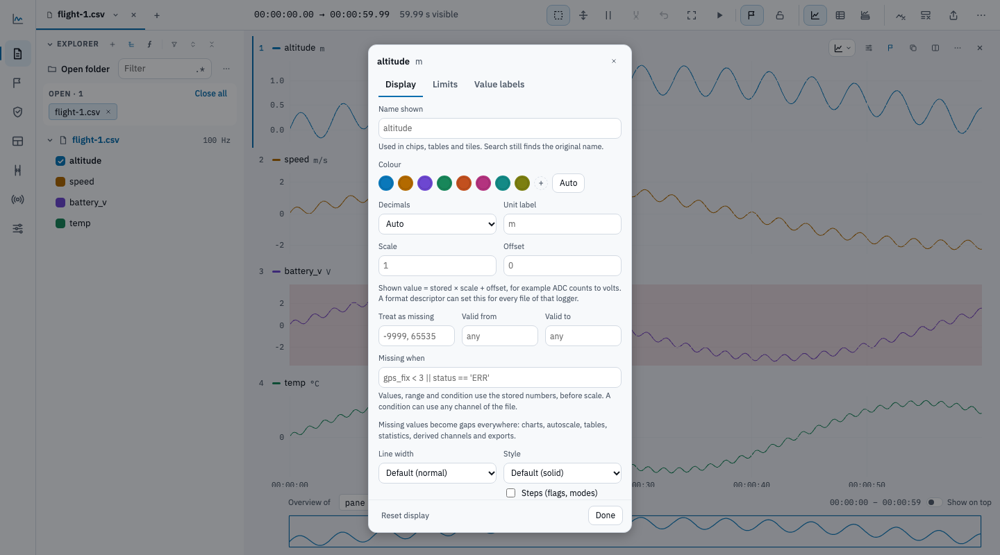
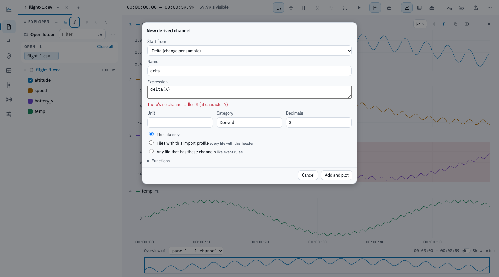

# Channels

A channel is one column of a recording: a name, a unit and a series of values over time. This chapter covers how a channel looks (colour, line width, style, units, limits), what happens where values are missing, how a channel of text reads, how Explorer groups channels into categories, and how to compute new channels from existing ones. Display settings belong to the channel's name, so they follow it into every pane and every file that has it.

## Change how a channel looks

Click a channel's chip in a pane, or right-click the chip or the channel in Explorer and choose **Display…**. The channel editor has three tabs: **Display**, **Limits** and **Value labels**. Changes apply as you make them. **Done** closes it; **Reset display** puts the Display tab back to its defaults.

On the **Display** tab:

| Field | What it does |
| --- | --- |
| **Name shown** | A shorter or clearer name for chips, tables and tiles. Search still finds the original name. |
| **Colour** | One of eight palette colours, a custom colour (the **+** swatch), or **Auto** to let the app choose. |
| **Decimals** | How many decimals values show: **Auto**, or 0 to 6. |
| **Unit label** | Replaces the unit the file gives. Empty keeps the file's unit. |
| **Scale** and **Offset** | The shown value is stored × scale + offset, for example ADC counts to volts. A format descriptor can set this for every file from one logger. |
| **Line width** | **Thin**, **Normal**, **Thick** or **Heavy**. The first choice follows the default in **Settings › Display › Default line width**. |
| **Style** | **Solid** or **Dashed**; the first choice follows **Settings › Display › Default line style**. |
| **Steps (flags, modes)** | Draws the channel as steps instead of sloping lines, so a flag or mode changes sharply. |

## Units

A channel's unit comes from the file (in a CSV, a unit in brackets after a space in the header, like `[m/s]`). To show another label, set **Unit label**. To change the number as well, use **Scale** and **Offset**. A derived channel carries the unit you give it in the Derive dialog.

## Warn and alarm limits

Open the **Limits** tab (or click a value tile on a values pane) and type up to four numbers:

- **Alarm at or below** and **Alarm at or above**
- **Warn at or below** and **Warn at or above**

Leave a box empty for no limit on that side. Charts draw each limit as a dashed line with shading beyond it: yellow past a warn limit, red past an alarm limit. Value tiles and gauges turn green, yellow or red. **No limits** clears all four.

Limits go by the channel's own name, so `temp`, `temp·2` and every file's copy share them. When a tab holds several files the tab says "Applies to every file with …". Checks can use the same limits (`past_warn(temp)`, `past_alarm(temp)`; see chapter 8).

## Missing values and gaps

TelemetryBench never invents data. Missing samples are gaps, and a gap breaks the line.

**Mark values as missing.** On the **Display** tab:

- **Treat as missing** takes a list of sentinel values, such as `-9999, 65535`.
- **Valid from** and **Valid to** treat everything outside the range as missing.
- **Missing when** takes a condition over any channel of the file, for example `gps_fix < 3 || status == 'ERR'`. Combine conditions with `&&` and `||` (see [The expression language](#the-expression-language)).

Values, range and condition use the stored numbers, before scale. A mistake in the condition is shown under the field. Missing values become gaps everywhere: charts, autoscale, tables, statistics, derived channels and exports. The editor says how many samples are missing in the file now.

**Time jumps.** A jump in time longer than the channel's gap factor times its median sample interval also breaks the line. The default factor is 4, and the smallest you can set is 2.

1. Right-click the channel (its chip or its row in Explorer) and choose **Gap factor…**.
2. Type a number of median intervals. The dialog reads "× the median interval".
3. Press **Apply**, or **Reset to 4** to go back.

The gap factor is kept per file and channel. A file with a fixed sample rate has no time jumps, so the dialog says there are no gaps to break.

**How a gap is drawn.** **Settings › Display › Gaps in lines** chooses **Break the line** (the default) or **Connect with a dashed line**. The dashed segment is there so a gap is never mistaken for data.

## Value labels and text channels

A channel can show text for its values, such as `0 = IDLE`, `1 = ARMED`, `2 = CRUISE`.

1. Right-click the channel and choose **Value labels…** (or open the **Value labels** tab).
2. Type one label per line as `value = text`.
3. Close the editor. **No labels** removes them.

Tiles, tables and Measure show the text; a value with no label shows as a number. Expressions can compare against the text in single quotes: `state == 'CRUISE'`. Labels are saved in settings for the channel name, in every pane and file.

**Text columns in a CSV.** A text column in the import dialog (**Number**, **Text** or **Skip** per column) opens as a labelled channel when it has 256 different texts or fewer: each text becomes a code, and axes, readouts and checks show the text. A column with more than 256 different texts is left out, and the import dialog says so under its row.

## Categories in Explorer

Explorer groups a file's channels into categories. The button **Show categories** in Explorer's header switches between the grouped tree and a flat list. A category row has **Add**, **Chart** and **Table** to plot the whole group, and a count of channels plotted anywhere out of the total.

A channel's category is, in order of priority:

1. The one you chose: right-click the channel, **Move to a category…**, pick or type a name, **Move**. It is kept for that file. **Use the default** undoes it. You can also drag channels onto a category row.
2. The one the import dialog's **Category** column or a format descriptor gives.
3. The part of its name before the first `_` or `.`, when at least two channels share it.
4. **other**, listed last.

In a tab with several files, Explorer groups by file first and shows each file's channels in a plain list.

## Derived channels

A derived channel is computed from other channels by an expression. It behaves like any channel: you can plot it, tabulate it, give it limits and use it in checks. Explorer marks it with **ƒ**. The core evaluates it over every sample and caches the result; nothing is written next to your data.

### Make one

1. Select one or two channels in Explorer, then press **Derive…** in the selection bar. (With nothing selected, press **ƒ** in Explorer's header, or right-click a channel and choose **Derive…**.)
2. In **Start from**, pick a template, such as **Delta (change per sample)**, **Moving average (20 samples)** or **Drawdown %**. With two channels selected the templates are **A − B**, **A ÷ B**, **A × B** and **A + B**.
3. Name it, and edit the **Expression**. Suggestions appear as you type for functions, channel names and, after `== '`, the channel's value labels. **Tab** or **Enter** accepts one.
4. Read the line under the box: it says what the expression gives, or names the character where it goes wrong.
5. Set **Unit**, **Category** and **Decimals**, then choose **Where it applies**.
6. Press **Add and plot**.

**Where it applies:**

- **This file only**.
- **Files with this import profile** (CSV files only): every file with the same header.
- **Any file that has these channels**: the recipe is applied automatically to every file that has all the channels it needs.

Everything you make is kept as a *recipe*: a name, an expression, a unit, a category and decimals. Recipes live in one library in the app cache. A recipe applies to a file when it is marked for any file with its channels, when the file's import profile picks it, or when you added it to that file, and only if every channel it needs exists. A recipe can use other recipes.

### Edit, copy and remove

Right-click a derived channel for **Edit recipe…**, **Duplicate recipe…**, **Derive from this…**, **Remove from this file** and **Remove from every file**. In the edit dialog, **Save** changes the recipe where it applies now; **Save as new** keeps the original and adds your changes as another recipe.

### The recipe library

Open **Recipes and profiles…** from Explorer's folder menu or its ⋯ menu. The **Recipes** tab lists each recipe with its unit, category and expression, and a checkbox **Any file with these channels**. Each row has **Edit**, **Pin**, **Duplicate** and **Delete**. **Export…** shows the library as TOML text to copy; **Import…** takes pasted text back, and a recipe with the same name is replaced. **Import profiles** lists what you decided for each CSV header, including the recipes its files get.

**Share…** in the folder menu writes each recipe to the folder's `.tlmbench/recipes/` so colleagues get them.

### Channels from other files

In a tab with several files, name another file's channel the way the tab shows it: `"Close·2"` (file 2's `Close`), or by that file's short name, such as `"MS Close"`. A recipe that reads two files on purpose, such as `temp - "temp·2"`, stays one channel. A recipe made for any file with these channels gives each file its own copy (`temp_avg`, `temp_avg·2`). Inputs at different rates resample to the fastest one, holding the slower one's last sample; `interp(x)` resamples linearly instead. See chapter 6.

### The expression language

The same language drives derived channels, rules, checks and the **Missing when** condition.

- **Numbers** `12`, `0.5`, `1e3`. **Durations** `250ms`, `5s`, `2min`, `1h`, `30d`, `2wk`.
- **Constants** `pi` and `e`.
- **Channel names** are bare when they use letters, digits, `_` and `.` (`battery_v`). Put anything else in double quotes: `"Battery V"`. Within quotes, `|` gives alternatives and takes whichever exists: `"Close|Adj Close"`.
- **Value labels** go in single quotes: `flight_mode == 'Mission'`.
- **Arithmetic** `+ - * / % ^`. `×`, `÷` and `−` also work. `^` binds tighter than a minus sign, so `-x ^ 2` is `-(x ^ 2)`.
- **Comparisons** `< <= > >= == !=` give 1 or 0.
- **Logic** `&&` (and), `||` (or) and `!` (not). The words `and` and `or` are not understood.
- **Gaps** are skipped by sample-to-sample and rolling functions.

Windows take either a number of samples (`20`) or a time (`5s`, `30d`).

### Function reference

Argument names in brackets are optional. *x* is a channel or an expression; *cond* is an expression read as true when it is not 0. The plain list of names and argument counts is generated from the source: [Expression functions](../reference/expressions.md).

**Math** (element by element)

| Function | Arguments | What it does |
| --- | --- | --- |
| `abs` | x | Absolute value. |
| `sqrt` | x | Square root. |
| `ln`, `log` | x | Natural logarithm. |
| `log10` | x | Base-10 logarithm. |
| `exp` | x | e to the power x. |
| `pow` | x, y | x to the power y. |
| `floor`, `ceil` | x | Round down, round up. |
| `round` | x, [decimals] | Round to a number of decimals (0 if omitted). |
| `sign` | x | −1, 0 or 1. |
| `clamp` | x, low, high | Limit x to the range low to high. |
| `sin`, `cos`, `tan` | x | Trigonometry, x in radians. |
| `asin`, `acos`, `atan` | x | Inverse trigonometry, giving radians. |
| `atan2` | y, x | Angle of the point (x, y), in radians. |
| `deg`, `rad` | x | Radians to degrees, degrees to radians. |
| `if` | cond, a, b | a where cond is true, otherwise b. |
| `min`, `max` | a, b, … (up to 9) | The smaller or larger of the arguments, at each sample. With one channel it is a whole-file number (see below). |

**Sample to sample**

| Function | Arguments | What it does |
| --- | --- | --- |
| `delta`, `diff` | x | x minus the previous sample. |
| `prev` | x, [n] | The value n samples earlier (1 if omitted). |
| `pct_change` | x | x ÷ previous x − 1. A gap where the previous value is 0. |
| `rate` | x | Change per second between samples. |
| `cumsum` | x | Running total. |
| `integral` | x | Integral over time (trapezoid rule), in the unit times seconds. |
| `running_max`, `running_min` | x | The highest or lowest value so far. |

**Rolling windows** (window in samples, default 20, or a time)

| Function | Arguments | What it does |
| --- | --- | --- |
| `sma`, `rolling_mean` | x, [window] | Moving average. |
| `rolling_std` | x, [window] | Moving standard deviation. |
| `rolling_min`, `rolling_max` | x, [window] | Lowest or highest value in the window. |
| `rolling_sum` | x, [window] | Sum over the window. |
| `ema` | x, [window] | Exponential average. A sample window n weights new values by 2 ÷ (n + 1); a time window is the decay time. |
| `movavg` | x, [window] | Moving average, the same as `sma`. |
| `median` | x, [window] | Moving median. |

**Filters** (cutoffs in Hz, below half the sample rate)

| Function | Arguments | What it does |
| --- | --- | --- |
| `lowpass` | x, Hz | Keeps what changes slower than the cutoff. |
| `highpass` | x, Hz | Keeps what changes faster than the cutoff. |
| `bandpass` | x, low Hz, high Hz | Keeps frequencies between the two cutoffs. The second must be higher. |
| `interp` | x | Resamples x linearly onto the timestamps it is combined with, instead of holding the last sample. |

Filters run forward and backward on recorded files (no phase shift) and forward only on live data.

**One number for the whole file** (shown as a flat line; Explorer shows the value)

| Function | Arguments | What it does |
| --- | --- | --- |
| `mean`, `sum` | x | Mean and sum of the samples. |
| `std` | x | Sample standard deviation. |
| `min`, `max` | x | Lowest and highest value (one argument). |
| `first`, `last` | x | The first and last sample. |
| `count` | x | How many samples are not gaps. |
| `pct` | cond | Percentage of samples where cond is true. |
| `duration` | cond | Seconds for which cond was true. |
| `occurrences` | cond | How many times cond became true. |

**Over time**

| Function | Arguments | What it does |
| --- | --- | --- |
| `since` | cond | Seconds since cond last held. It is a gap before the first time it held. |

**Limits**

| Function | Arguments | What it does |
| --- | --- | --- |
| `past_warn` | channel | 1 where the channel is at or beyond a warn limit, otherwise 0. Needs a channel with limits set. |
| `past_alarm` | channel | The same for alarm limits. |

Function names are not case-sensitive. A call with the wrong number of arguments, or a name that doesn't exist, is reported with the character where it goes wrong.
