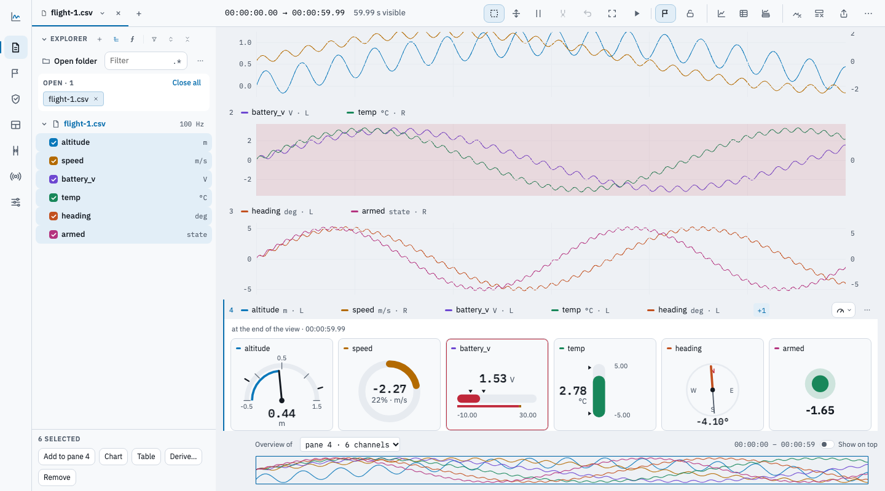
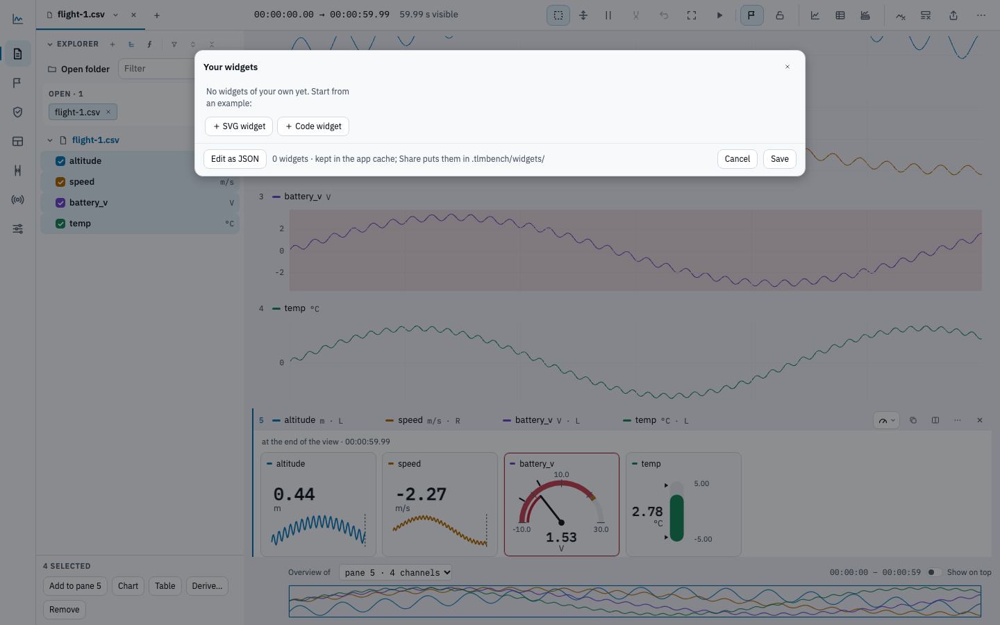

# Widgets and gauges

A Gauges pane shows one widget per channel: a dial, a bar, a ring, a compass, a horizon and more. Each reads the value at the pointer, the playhead, cursor A or the end of the view, and takes its colours from the channel's limits, so a gauge and a chart always agree. When none of the built-in widgets suits, you can draw your own as an SVG or write a small code widget. This chapter also covers icons, and pinning layouts and recipes to the top bar.

## The Gauges pane

1. Open the pane's view menu and choose **Gauges** ("One widget per channel").
2. Tick channels in Explorer to add them. With nothing in the pane it says "Tick channels on the left to show them here".

Each channel gets the widget that fits its unit and name:

| Widget | Shows | Chosen automatically when |
| --- | --- | --- |
| **Gauge** | A semicircle dial with a needle. | The unit is rpm or V, or the name has `rpm`. |
| **Ring** | Circular progress, 0 to 100% of the range. | The unit is %. |
| **Bar** | A horizontal bar with limit marks. | The unit is A or W. |
| **Tank** | A vertical level, like a thermometer. | The unit is °C, or the name has `temp`. |
| **Sparkline** | The value with its trace over the time view. | Anything else. |
| **State light** | A light coloured by limits, with the value's label. | A flag, or a channel with one or two value labels. |
| **State timeline** | The current state, with a strip of states across the view. | An enum, or a channel with more than two value labels. |
| **Compass** | Heading in degrees on a dial. | The name has `yaw`, `heading`, `course` or `bearing`. |
| **Horizon** | An artificial horizon from roll and pitch. | A roll channel in degrees (it finds `pitch` beside it). |
| **Flags** | One light per bit of a status word. | The unit is `bits`. |
| **Number** | A big value with its trend over the last second. | On request. |
| **Commanded vs actual** | Actual as a bar, the command as a tick, and the difference. | A channel with a companion named `_target`, `_cmd`, `_command`, `_set`, `_setpoint`, `_sp`, `_req` or `_demand`. |
| **Bar group** | Similar channels on one scale, so the odd one out stands out. | Three or more channels that differ only by a number (`motor_2_rpm`, `cell_4_v`). |
| **XY dot** | Two channels as a dot with a short trail (a g-g diagram, a stick, a GPS track). | A channel with an `_x`/`_y` partner or latitude/longitude. |

A card turns yellow or red with the channel's warn or alarm limits, and says "✗ check" while a failing check covers the time it reads. Click a card to open the channel's limits (**Limits** tab).

### Change a widget

Press **⋯** on a card ("Choose the widget, or set its range"). The menu offers:

- **Automatic** with the type it would pick, or any widget type from the list. Pairs and groups the app finds are offered too: **Commanded vs actual, with …**, **XY dot, with …** and **Bar group, with … similar**. **Separate** or **Ungroup** splits them again.
- **Your widgets ▸** (or **Make a widget…** when you have none) for widgets you or the folder made.
- **Min/max in view** on dials, bars and tanks: marks the lowest and highest value in the view.
- **Size**: **Small**, **Medium**, **Large (2 wide)** or **2 × 2**.
- **Range…**: the dial's minimum and maximum as "min, max". Empty is automatic, from the channel's range and limits.
- **Inputs and settings…** and **Edit this widget…** for a code widget.

Widget choices are kept with the layout.

## Your widgets

Open **Your widgets** from the widget menu (**Make a widget…** or **New or edit widgets…**), or from **Settings › Widgets › Edit…**. The dialog has your widgets on the left and a form on the right, with a live preview at 62% of the range.

1. Press **SVG widget** or **Code widget** to start from a working example.
2. Edit the **Name**, an optional **Icon** (an SVG used in menus) and the widget itself.
3. Check the **Preview**.
4. Press **Save**.

The list marks each widget **SVG**, **Code** or **Shared**. **Duplicate** copies one; **Delete** removes yours. A shared widget is read-only: duplicate it to make a copy of your own.

### SVG widgets

An SVG widget is a picture with values bound in. Write the SVG in the **SVG** box and use these bindings anywhere in it:

| Binding | Value |
| --- | --- |
| `{{value}}` | The reading as text, with decimals or the value label. |
| `{{unit}}` | The unit. |
| `{{label}}` | The value's label, or the value text when it has none. |
| `{{pct}}` | The position in the range, 0 to 100. |
| `{{angle}}` | The rotation for the position, between the two numbers in **Angle** (default −120 to 120 degrees). |
| `{{color}}` | The colour from the limits: normal, warn or alarm. |
| `{{level}}` | `ok`, `warn`, `alarm` or `none`. |
| `{{min}}`, `{{max}}` | The ends of the range. |
| `{{name}}` | The channel's name. |

Scripts, event handlers and links that point outside the document are removed before it is used.

### Code widgets

A code widget is a small piece of JavaScript that draws inside its card. Write an object with two functions in the **Code** box:

- `build(el, info)` runs once. `el` is the card's element. `info` has `name`, `unit`, `min`, `max`, `fg` (the text colour), `params` and `roles`.
- `update(el, x)` runs for each new reading, at most ten times a second. `x` has `v` (the number, or `null`), `txt`, `pct` (0 to 100), `color`, `level` (`ok`, `warn`, `alarm` or `none`), `unit` and `series` (the last 64 samples), plus `inputs` and `params`.

It runs in a sandbox: it can draw in its card and read the values it is given, with no files, no network and no other windows.

**Inputs** let a widget read more than the channel it sits on. Press **Add input** and give a *role* (such as `pitch`) and an optional label. When the widget is placed, pick a channel for each role in the widget's menu, under **Inputs and settings…**. In `update`, each role is in `x.inputs`, with `name`, `unit`, `v`, `txt` and `series`.

**Parameters** are settings for each placed widget. Press **Add parameter**, give a name, label and type (**Number**, **Text** or **Choice**, with a comma-separated list of choices) and a default. Set values in the widget's menu under **Inputs and settings…**; they are kept with the layout and read in `x.params`.

### Edit as JSON

**Edit as JSON** at the bottom of the dialog shows all your widgets as one JSON text, each with `name`, `icon`, and `svg` (with `angle`) or `code` (with `inputs` and `params`). Edit it and press **Edit as a form** to go back; a mistake keeps the JSON open and names it.

## Widgets from a shared folder, and trust

**Share…** writes your widgets to the folder's `.tlmbench/widgets/`, so colleagues see them as **Shared**. An SVG widget needs no permission. A shared code widget does: until you decide, it shows as a plain value card with a **Code widget · Run?** button. The question names who shared it and from which folder, says what the sandbox allows, and lets you open **Show the code** first. Choose **Run widgets from this folder** to trust that folder, or **Keep as value cards**. Code you wrote yourself never asks.

**Settings › Run code widgets** turns code widgets off everywhere ("Code widgets are off" on the cards), for a machine that must not run any shared code.

## Icons

Icons appear on event categories, on custom widgets and on anything you pin to the top bar. In **Settings** (the **Icons** section):

1. Type a **Name**.
2. Paste an SVG into the box, for example `<svg viewBox="0 0 24 24" stroke="currentColor">…</svg>`. An SVG that uses `currentColor` follows the theme. A preview appears.
3. Press **Add**.

The trash button deletes an icon. Icons shared by the folder are listed too, marked "shared in the folder". Share writes yours to `.tlmbench/icons/`. Pick an icon for an event category in **Settings › Event categories**, and for a pinned item in **Pinned to the top bar**.

## Pin layouts and recipes to the top bar

Pin what you open often so it is one click away.

- **Layouts**: in the Layouts sidebar, press the pin button on a layout (yours, or one shared in the folder), or right-click it and choose **Pin to the top bar**.
- **Recipes**: in **Recipes and profiles…**, press **Pin** on a recipe.

Pinned items show as buttons on the top bar. Click a layout to open it, or a recipe to add it to the file in front. Right-click for **Unpin from the top bar**. **Settings › Pinned to the top bar** lists them, lets you pick each one's icon and unpin it with the × button.
