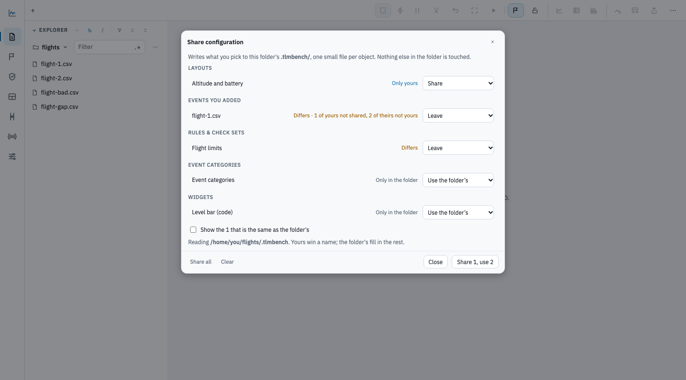
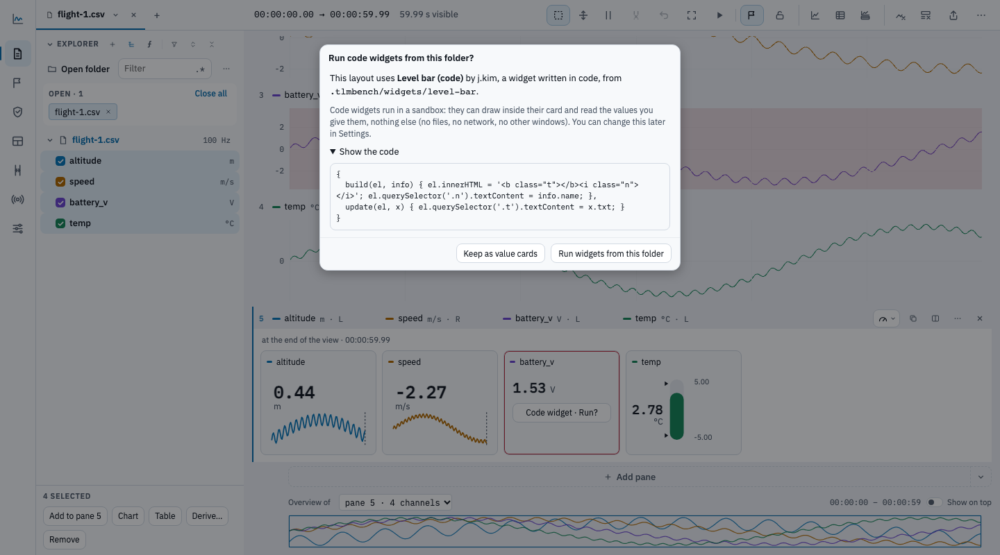

# Sharing with a folder

Everything you define in TelemetryBench (layouts, rule and check sets, recipes, events, widgets, icons, decoders) starts as personal: it lives in the app's cache, on your computer only. To give it to a team, you share it into the recordings' folder, in a small `.tlmbench/` folder of plain files that anyone who opens that folder, and the command line and Python too, reads. This chapter says what that folder holds, how **Share…** writes it, what to do when the folder is read-only, and when a folder's code is allowed to run.

## What `.tlmbench/` holds

`.tlmbench/` sits at the root of the folder you open in Explorer. It holds configuration only: no recordings, no caches, nothing generated.

| Folder or file | What it holds | Format |
| --- | --- | --- |
| `views/<name>.tlmview.json` | Layouts: panes, channels, time range | JSON |
| `checks/<set>.toml` | Rule and check sets, one `[[check]]` table per row | TOML |
| `categories.toml` | Event categories: name, colour, shown on charts | TOML |
| `recipes/<recipe>.toml` | Derived-channel recipes | TOML |
| `profiles/<profile>.toml` | CSV import profiles | TOML |
| `decoders/<format>.toml` | Format descriptors for binary files | TOML |
| `events/<recording>.toml` | The events you added to a recording (markers, ranges) | TOML |
| `widgets/<name>/` | A widget: `widget.toml` plus its SVG or code (`widget.js`) | TOML and SVG or JS |
| `icons/` | Icons for categories and pins | SVG |
| `timemaps/<name>.toml` | How two files line up | TOML |
| `plugins/` | WASM and native plugins the folder shares | binary |

TOML is for what people edit and review. JSON is for layouts, which nobody edits by hand. Every file is its own small object, so changing one rule is a one-file change. The app writes keys in a fixed order, with no timestamps, and refers to channels by name and to recordings by path relative to the folder, never an absolute path. Saving an unchanged object rewrites nothing.

That makes `.tlmbench/` suitable for version control: commit it next to the recordings, or keep it in its own repository and point the command line at it with `--config` (see [the command line](16-command-line.md)). Recordings belong in Git LFS or on a file share. Share can add the recordings' file patterns to the folder's `.gitignore` for you, in a git repository.

The `examples/recordings/.tlmbench/` folder in the repository shows each kind of file as the app writes it.

## Share…

Open the folder in Explorer, then choose **Share…**: in the Explorer's folder menu, or in **Settings** under **Shared configuration**. It is greyed until a folder is open.

The dialog lists everything you have, grouped by kind: **Layouts**, **Events you added**, **Rules & check sets**, **Event categories**, **Recipes**, **Import profiles**, **Decoders**, **Widgets**, **Icons** and **Time maps (alignment)**. Each row says how it stands against the folder:

| Status | Meaning | Default choice |
| --- | --- | --- |
| **Only yours** | The folder doesn't have it | **Share** |
| **Differs** | You and the folder both have it, and they differ | **Leave** |
| **Same** | Identical (hidden unless you tick the box at the bottom) | none |
| **Only in the folder** | You don't have it | **Use the folder's** |

For a row that differs you pick **Share mine** or **Use the folder's**; for events, **Share (merges)** joins your events with the folder's. Nothing overwrites a colleague's file unless you choose it. **Share all** picks Share on every row that can take it; **Clear** puts every row back to **Leave**.

The button at the bottom says what it will do, for example **Share 3, use 1**. It writes only what changed: an object that is the same as the folder's is not touched, and nothing else in the folder is written. In a git repository, **Keep recordings out of git (adds them to .gitignore)** is ticked by default.

Files in the folder that don't read are listed in red with the reason, so a broken file is visible instead of silently skipped.

### Using what the folder has

Once a folder with a `.tlmbench/` is open, the app reads it next to your own: its recipes, check sets, decoders, profiles and events appear alongside yours, and **Settings** says **Reading the folder's .tlmbench/**. Yours win a name; the folder's fill in the rest. Event categories from the folder win a shared id, so a shared rule looks the same for everyone.

### Layouts: shared views

A layout is shared from its tab: open the tab's **⌄** menu and choose **Share with this folder…**, give it a name, and it is written to `.tlmbench/views/`. A shared layout carries the panes, the file (by its path in the folder) and the time range it was saved with. If you change a layout you opened from the folder, **Update shared copy…** writes it back, and **Save as…** keeps your own copy instead.

Shared layouts show in the **+** menu under **Shared in this folder · .tlmbench/**, and in the Explorer as a `.tlmbench` entry. They open like your own and can be pinned to the top bar.

## Read-only folders

TelemetryBench never writes next to your data except when you ask. A folder on a read-only share, a mounted image or a locked drive can still be opened and used fully: the app keeps everything it learns in its own cache.

You can't share into such a folder. When the app sees that the folder looks read-only:

- The Share dialog is titled **Export configuration**, and its button is **Export…**. It writes the same files to a folder you choose. Put that folder next to the recordings later, or point `--config` at it.
- A tab's **⌄** menu offers **Export file…** (marked **Folder is read-only**) instead of **Share with this folder…**. It saves the layout as a `.tlmview.json` where you choose.

If a folder looked writable but refused the write (a network share, a lock), the app says so and offers **Export file…** in the same note.

## Trusting a folder

A shared folder can carry things that run: code widgets and plugins. Both run in a sandbox, and both ask first.

**Code widgets.** A widget made of code can draw inside its card and read the values you give it. It can't reach files, the network or other windows. The first time a layout uses a code widget from a folder, a question appears: **Run code widgets from this folder?** It names the widget, who made it and where it came from, and **Show the code** lets you read it. Choose **Run widgets from this folder** to allow it (remembered for that folder) or **Keep as value cards** to show the widget as a plain value card. Code you wrote yourself never asks. To refuse every shared code widget on a machine, turn off **Run code widgets** in **Settings**.

**Plugins.** A folder's `.tlmbench/plugins/` is not loaded until you trust the folder. When you open a folder that shares plugins, a note says so. In **Settings**, under **Plugins**, the folder's row reads *This folder has N plugins waiting for your OK*. Choose **Trust this folder's plugins** to load them, or **Stop trusting** later. Plugins decide how files decode and align, so trust a folder only when you trust who shared it. WASM plugins can't reach your files or network. Native plugins run with your rights and stay off until you turn each one on, whoever shared them.

