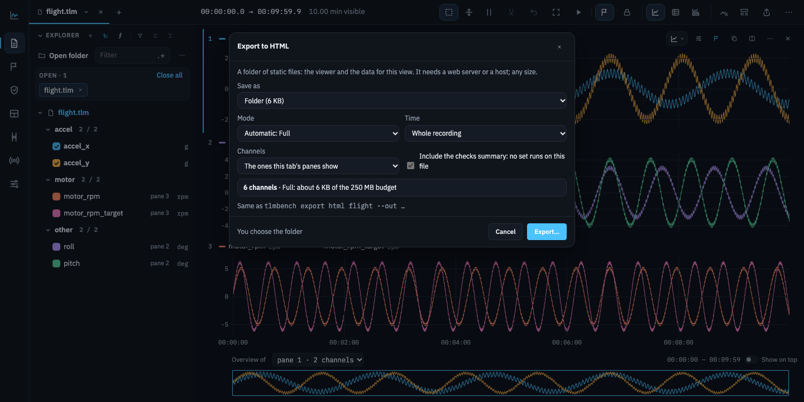
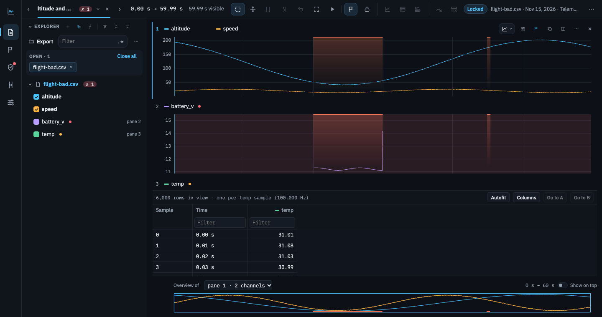
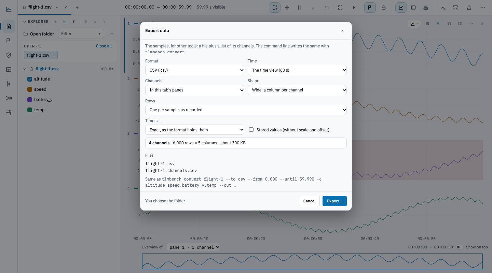
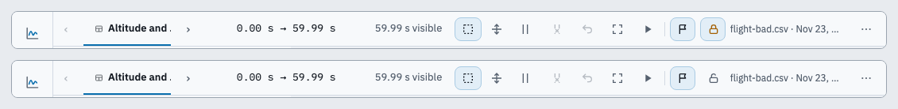

# Exporting

You can take your work out of TelemetryBench in three ways: the samples as a data file for other tools, the view as a picture, and a whole view with its data as a web page anyone can open. Data and image exports are in the **Export** menu on the top bar and in the **File** menu; the web page is **Export to HTML…**. Every export is a static file or folder, and nothing is written except where you choose.

All three work on the tab in front. The command line does the same without the app: `tlmbench convert` for data, `tlmbench export html` for the page (see [the command line](16-command-line.md)). Each dialog shows the command that matches your choices under **Same as**.

## Export data…

Writes the samples of the tab's channels as a file for other tools. Choose **Export data…**, set the options and press **Export…**. You choose the folder at that point.

| Setting | Choices |
| --- | --- |
| **Format** | CSV (`.csv`), Parquet (`.parquet`), Arrow IPC (`.arrow`), HDF5 (`.h5`), MAT v7.3 (MATLAB) (`.mat`) |
| **Time** | **The time view**, **Between cursors A and B** (place both cursors first), or **Whole recording** |
| **Channels** | **In this tab's panes**, or **Every channel of the file** |
| **Shape** | **Wide: a column per channel**, or **Long: a row per sample and channel** (CSV, Parquet and Arrow only) |
| **Rows** | **One per sample, as recorded**, or **Resampled**: one row per step of the **Rate (Hz)** you enter, each channel holding its last value |
| **Times as** | **Exact, as the format holds them**, **Seconds from the start**, **Dates and times (ISO 8601)** or **Nanoseconds** |
| **Stored values (without scale and offset)** | Off by default: values are written as shown, with scale and offset applied |

The summary line shows the number of channels, rows and columns and an estimate of the size. Besides the data file, the export writes `<name>.channels.csv`, a list of the channels with their units. The export reads the full data, not the on-screen reduction: masks and filters in a view don't change what is written.

## Save the view as an image…

Writes the panes as they look now (traces, axes, cursors and markers, in the current theme). Choose **Save the view as an image…**, then:

- **Format**: **PNG (picture)** or **SVG (drawing, scales without blur)**.
- **What**: **Every pane** (one image of all of them) or **The selected pane** (the file is named `<name>-pane-<n>`).
- **Size** (PNG only): **As on screen** or **Twice as sharp**. The default is twice as sharp.

Press **Save…** and choose where. This also works in an HTML export's viewer.

## Export to HTML…

Writes the tab's view, with its data and a viewer, as static files. Whoever opens it sees the same panes, can zoom, pan, place cursors and read values, with nothing to install and nothing to run on a server. Everything is computed in the page, by the same core compiled to WebAssembly.

### Folder or one file

**Save as** offers two forms, each with its size shown:

- **Folder**: `index.html`, the viewer's script, the core as WebAssembly, `export.json` and the data in chunks. Any size. It needs a web server or a static host (a file share that serves pages works too): a browser won't let a page opened from your disk by double-click load its own script, the core or the data. If someone does that, the page says so. To look at a folder export yourself, serve it, for example with `python3 -m http.server` inside the folder, and open the address it prints.
- **One file**: a single `.html` that opens from anywhere: email, a file share, a double-click. It is still static and fetches nothing. The price is size: the data is stored as text, a third bigger, so the file has a limit. It starts at 25 MB; change it with **Size limit (MB)**.

### Full or Light

**Mode** is **Automatic**, **Full** or **Light**, each with its size.

- **Full** carries every raw sample of every channel. Charts, tables, values and exact statistics all work.
- **Light** carries the min/max summaries (the pyramid) for every channel, and raw samples only where needed: channels shown as a table, values or XY, and windows around events and check violations. Charts are drawn from summaries and labelled *coarse* where raw samples aren't there; a table, a value at the cursor or an exact statistic is left blank rather than guessed.
- **Automatic** picks Full when it fits the size budget, otherwise Light.

For Light, **Raw around events**, **At least (s)** and **At most (s)** set the raw windows kept around each event or violation (a multiple of its length, with a minimum and a cap). The default is 3 times the length, at least 30 s and at most 10 min.

### The size budget

A folder export has a budget of 250 MB. A one-file export has the limit you set. The dialog shows the size of what you'd write against it, for example *Full: about 118 MB of the 250 MB budget*. If even Light is over, the finest detail of the biggest channels is left out, and the viewer says so when you zoom past it. If a one-file export can't fit at all, the command-line version says so and suggests fewer channels, a shorter time range, a higher limit or a folder.

### What goes in

- **Time**: **Whole recording** or **The time view**.
- **Channels**: **The ones this tab's panes show** or **Every channel of the file**.
- **Include the checks summary**: adds the result of the check sets that run on this file, with violations marked on the charts.

The export carries the tab's panes as the opening layout. Widgets of your own travel without code: an SVG widget is sanitised (no scripts, images, event handlers or outside links), and a code widget becomes a card that shows the value, its unit and the widget's name. To leave channels out of everything (data, layout and checks that read them), use `--redact` on the command line.

### The viewer

The viewer is the app's own interface, reduced to what a static page can do. It opens **Locked**: the time view and the panes are held, so a reader can't lose the view you chose. The header shows a closed lock while it is locked, and the export's file and date. Press **Unlock** (or **L**) to zoom, pan and rearrange freely; reloading locks it again, and nothing is saved. Anything that needs the app is left out, not greyed: saving, sharing, live sources, adding events or checks.

