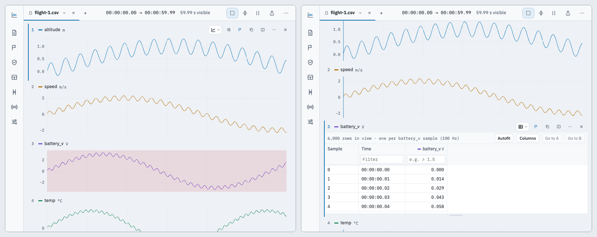
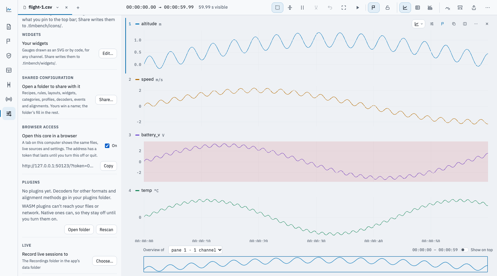

# Windows and browser access

TelemetryBench can show your work in several windows at once, for example one flight spread over two monitors. Every window is a client of the same core, so a file open in two windows is read and held once. This chapter covers moving tabs between windows, linking their time views, how windows come back after a restart, and opening the app in a browser tab on the same computer.

## What is shared and what isn't

| Shared by every window | Each window's own |
| --- | --- |
| Settings: a change shows in every window at once | Tabs, panes, the time view and cursors |
| Cached files and summaries | Which sidebars are open, their sides and widths |
| Live sessions: one ingest, shown in as many windows as you like | The Explorer's expanded folders |
| Recipes, rule and check sets, layouts, events | |

Closing a file in one window closes it only there.

## Open a tab in another window

- **Drag the tab out** of the tab bar and let go. If you drop it over another window's tab bar, it joins that window. Anywhere else, it opens a window of its own where you let go.
- Or open the tab's **⌄** menu and choose **Move to new window**.
- For a live tab, **Show in new window** keeps the tab where it is and shows the same source in a second window. The source records once and shows in both.

Tabs can be reordered inside a window by dragging. They don't dock or split inside a window; panes already sit side by side.

## Link the time view

Windows are independent by default: two windows on the same file can look at different moments. To make them follow each other, open the **⋯** menu in each window and turn on **Link time view with other windows**. Windows that link follow each other's zoom and pan. Turn on **Link cursors too** to share cursors A and B as well. Both are per window, and a locked window doesn't follow.

## Restoring windows

The app remembers where each window was and what it showed. When you quit with several windows open, the next start opens them again, each with its tabs, size and position. The first window's tabs come back with the folder's saved session (Settings › **Reset session** forgets it). If you close a window yourself, it is forgotten; quitting the app keeps every window for the next run.

## Browser access

Browser access serves the app's interface to a browser tab on the same computer. The tab shows the same files, live sources and settings as the app, and works as one more window. It is useful for a second screen, or for a browser's tools.

To turn it on, open **Settings**, find **Browser access** and switch **Open this core in a browser** to **On**. The page's address appears, with a **Copy** button. You can also start the app with `--browser`, which prints the address at launch.

- It listens on this computer only (`127.0.0.1`). Other machines can't reach it.
- The address carries a token, which lasts until you turn the switch off or quit the app. Anyone with the full address can use the app's files and settings in that tab, so don't share it.
- The tab needs the app running. Closing the app ends it.

To use the interface in a browser without the app at all, see [browser-only mode](18-browser-only.md).

