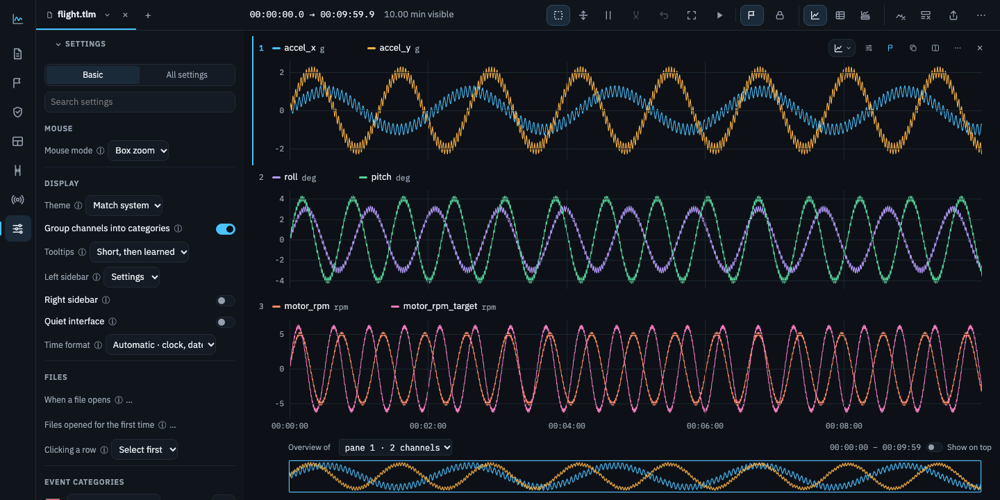
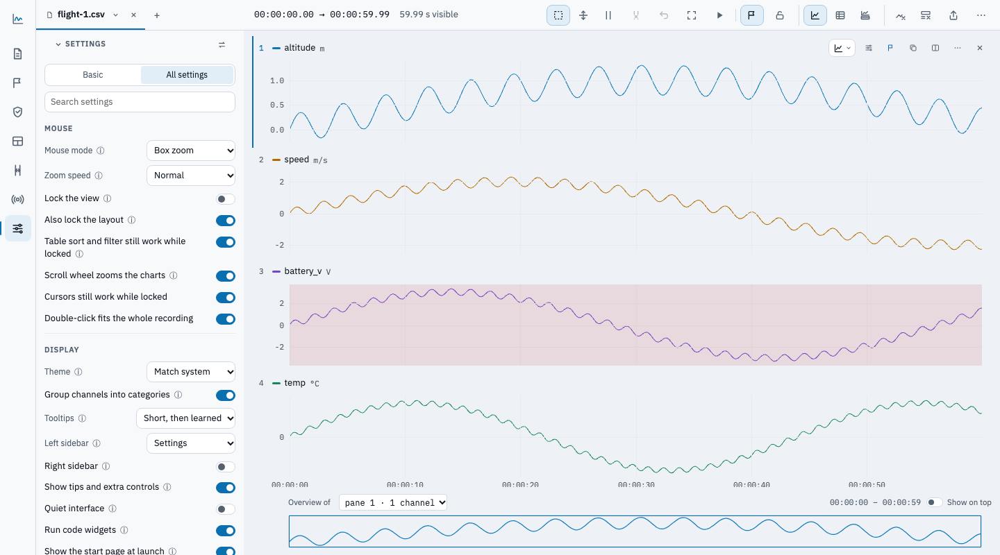
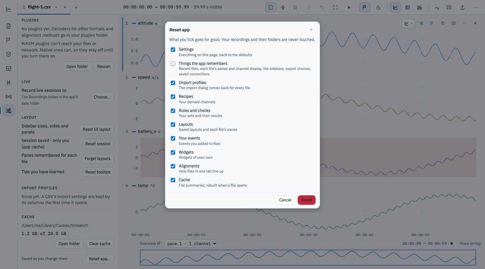

# Settings

Settings is a panel in the sidebar (open it from the rail, or **View › Settings…**, `⌘,` on a Mac, `Ctrl+,` on Windows and Linux). Every key it saves, with its type and default, is listed in the [settings reference](../reference/settings.md). Every change applies and saves at once; there is no Apply button. This chapter lists each setting as it is labelled, what it does and its default.

**Basic** shows the everyday settings; **All settings** shows the rest. The **Search settings** box looks through every setting's name, explanation and choices, whichever view you are in. The **ⓘ** beside a setting opens its explanation.

Settings are app-wide and apply to every window at once. The exceptions are layout: which sidebars are shown, their sides and widths, and which panel is in the left sidebar are kept per window.

## Mouse

| Setting | What it does | Default |
| --- | --- | --- |
| **Mouse mode** (Basic) | What dragging across a chart does: **Box zoom**, **Pan** or **Cursors**. Shift-drag or middle-drag always pans. | Box zoom |
| **Zoom speed** | How far one wheel notch or trackpad swipe zooms: **Slow**, **Normal**, **Fast**. | Normal |
| **Lock the view** | Zoom, pan and fit gestures can't change the time view. Also on the top bar (`L`). | Off |
| **Also lock the layout** | While locked, panes and their channels stay put: no moving, adding, closing or resizing. | On |
| **Table sort and filter still work while locked** | Off: each table keeps its current sort and filters. | On |
| **Scroll wheel zooms the charts** | Off: the wheel pans, and `Ctrl` + wheel zooms. | On |
| **Cursors still work while locked** | Cursors A and B can still be placed and moved. | On |
| **Double-click fits the whole recording** | Double-click on a chart fits the view to the data. | On |

## Display

| Setting | What it does | Default |
| --- | --- | --- |
| **Theme** (Basic) | **Match system**, **Light** or **Dark**. | Match system |
| **Group channels into categories** (Basic) | Explorer groups a recording's channels by the start of their names, before the first `_` or `.`. | On |
| **Tooltips** (Basic) | **Short, then learned** shows the first sentence and the shortcut, and each tip retires after three showings. **Full** always shows everything. **Off** shows none. | Short, then learned |
| **Left sidebar** (Basic) | What it shows, picked from the rail: **Explorer**, **Events**, **Layouts**, **Measure**, **Settings** or **Hidden**. | Explorer |
| **Right sidebar** (Basic) | Cursor values and stats, unless you moved other panels there. | Off |
| **Show tips and extra controls** | How-to notes in the panels. | On |
| **Quiet interface** (Basic) | Hides badges and readouts until they matter: the panes a channel is in, counts, chip values while you point at a plot, file numbers in the folder, resize grips. A pane's header keeps its view and **⋯**; the rest are in **⋯**. | Off |
| **Run code widgets** | Off: a widget made of code stays a plain value card and never asks to run. For a machine that must not run any shared code. | On |
| **Show the start page at launch** | Recent recordings and ways to open things, over your tabs when the app starts. | On |
| **Time format** (Basic) | For axes, readouts, tables and cursors: **Automatic**, **Clock, from start**, **Seconds**, **Milliseconds**, **Minutes and seconds**, **Hours**, **Days**, **Weeks**, **Years**, or **Wall clock** (files with absolute time). Clicking the time range in the top bar switches quickly. | Automatic |
| **Time decimals** | **Automatic**, or 0 to 6. | Automatic |
| **Time labels** | Which charts show the time axis: **Automatic (every chart on a narrow window)**, **Bottom chart only**, **Every chart**. | Automatic |
| **Draw every sample** | **Automatic** draws each sample only when there are at most four per pixel column, and reduces the rest to min and max per column (M4), which looks the same. The other choices, **Up to 100k per channel**, **Up to 1M per channel** and **Always (slow)**, draw every point; they are slower with millions of samples. | Automatic |
| **Default line width** | For every line without a width of its own: **Thin**, **Normal**, **Thick**, **Heavy**. A channel's own width wins. | Normal |
| **Default line style** | **Solid** or **Dashed**. A channel's own style wins. | Solid |
| **Gaps in lines** | Where data is missing (a time jump, a missing value): **Break the line**, or **Connect with a dashed line** so a gap is never mistaken for data. | Break the line |
| **Min/max band under reduced lines** | When a view has more samples than pixels, shades between the lowest and highest value of each pixel column, so a spike or a noisy stretch reads as an area. | On |
| **Overview above the panes** | Puts the overview strip above the panes instead of below. | Off |
| **Open Measure when both cursors are placed** | Measure closes again when you clear the cursors, unless you opened it yourself. | On |
| **Show performance details** | A status bar with the last view: points drawn, how they were reduced, and the round trip. | Off |

## Files

| Setting | What it does | Default |
| --- | --- | --- |
| **When a file opens** (Basic) | **Remember its last layout**, or always start from one of the starter choices below. A file opened for the first time uses **Files opened for the first time**. | Remember its last layout |
| **Files opened for the first time** (Basic) | **Starter charts** (one chart per group of channels, up to four), **Starter charts + tables**, **One table, every channel**, **One values pane**, or **Nothing plotted**. | Starter charts |
| **Clicking a row** (Basic) | **Select first**: one click selects a file or channel, double-click (or `Enter`) opens a file, the checkbox plots a channel. **Act at once**: one click opens or plots. | Select first |
| **Click a column header to sort** | Off: a click selects the column (`Shift`-click a range, `Ctrl` or `⌘`-click to add) and sorting is in each header's **▾** menu. | Off |
| **New pane from a dragged channel** | Dropping a channel where a new pane goes makes a **Chart**, or **Same view as where it came from** (a channel dragged out of a table makes another table). | Chart |

## Event categories

Each category has a colour, a name, an optional icon, a **Charts** switch (mark its events on charts) and a delete button. **Add** makes a new one. Deleting a category leaves its events as Uncategorized (grey). Charts mark an event when its category is on and the Events panel shows it. The starting set is Alarm, Data quality, Signal loss, Mode change, Milestone, Check failed and Trigger. A folder's categories win a shared id.

## Icons

Icons go on event categories and on what you pin to the top bar. To add one, type a **Name**, paste an SVG into the box (an SVG that uses `currentColor` follows the theme) and add it. Icons shared in the folder are listed with *shared in the folder*. **Share…** writes yours to `.tlmbench/icons/`.

## Widgets

**Your widgets**, with **Edit…**, opens the widget editor: gauges drawn as an SVG or by code, for any channel. **Share…** writes them to `.tlmbench/widgets/`.

## Pinned to the top bar

Appears once you pin a layout, a shared layout or a recipe. Each row has an icon choice (**Default icon**, or one of yours) and a button to unpin.

## Shared configuration

Says whether the app is reading the folder's `.tlmbench/`, and has **Share…** (greyed until a folder is open). Problems in the folder's files are listed here. See [sharing](11-sharing.md).

## Browser access

**Open this core in a browser**, **On**: serves the app to a browser tab on this computer, with the address and a **Copy** button. See [windows and browser access](13-windows.md). Default: off.

## Plugins

Lists the plugins found in your plugins folder (and the open folder's), each with its version, kind (**Decoder**, **Alignment**, **Payload**), tier (**WASM, sandboxed** or **Native, runs with your rights**) and whether it loaded, with the reason when it didn't. Native plugins have an **On** switch, off by default. A folder's plugins show *This folder has N plugins waiting for your OK* with **Trust this folder's plugins**, or *This folder's plugins are trusted* with **Stop trusting**. **Open folder** shows the plugins folder; **Rescan** reads it again.

## Channels

Appears when you've given channels a display, limits or value labels of their own: one row per channel, summarised, with **Reset**, and **Reset all** for every one.

## Live

**Record live sessions to**: the folder sessions are recorded into, with **Choose…** and **Default**. Default: the Recordings folder in the app's data folder.

## Layout

| Control | What it does |
| --- | --- |
| **Reset UI layout** | Sidebar sizes, sides and panels back to the start. |
| **Reset session** | Closes this folder's tabs and forgets its saved session. |
| **Forget layouts** | Forgets the panes remembered for each file. |
| **Reset tooltips** | Shows the tips you have already learned again. |

## Import profiles

The import settings kept for each CSV header, listed by their columns. The trash button forgets one: the import dialog comes back for files with those columns.

## Cache

The cache is where the app keeps what it learns about files: the pyramids, gap indexes and results. It lives outside your data, so a read-only folder works.

- The path is shown at the top, and the size as *used of the cap*, for example `2.4 GB of 20.0 GB`. The cap is 20 GB; the least recently opened entries go first when it is exceeded, or when the disk has less than 10 GB free. Entries in use by a file you have open stay.
- **Open folder** shows the cache folder in the file manager.
- **Clear cache** removes the summaries of files that aren't open. They are rebuilt when a file opens again. It keeps your settings, import profiles, recipes and sets.

The default location is the system's cache folder, in a `tlmbench` folder (for example `~/Library/Caches/tlmbench` on a Mac). Setting `TLMBENCH_CACHE` or passing `--cache` to the command line changes it there.

## Reset app…

At the bottom of the panel. It opens a list of what to remove, all ticked except **Things the app remembers**. What you tick goes for good. Your recordings and their folders are never touched.

| Item | What goes |
| --- | --- |
| **Settings** | Everything on this page, back to the defaults |
| **Things the app remembers** | Recent files, each file's panes and channel display, the sidebars, export choices, saved connections |
| **Import profiles** | The import dialog comes back for every file |
| **Recipes** | Your derived channels |
| **Rules and checks** | Your sets and their results |
| **Layouts** | Saved layouts and each file's panes |
| **Your events** | Events you added to files |
| **Widgets** | Widgets of your own |
| **Alignments** | How files in one tab line up |
| **Cache** | File summaries, rebuilt when a file opens |

