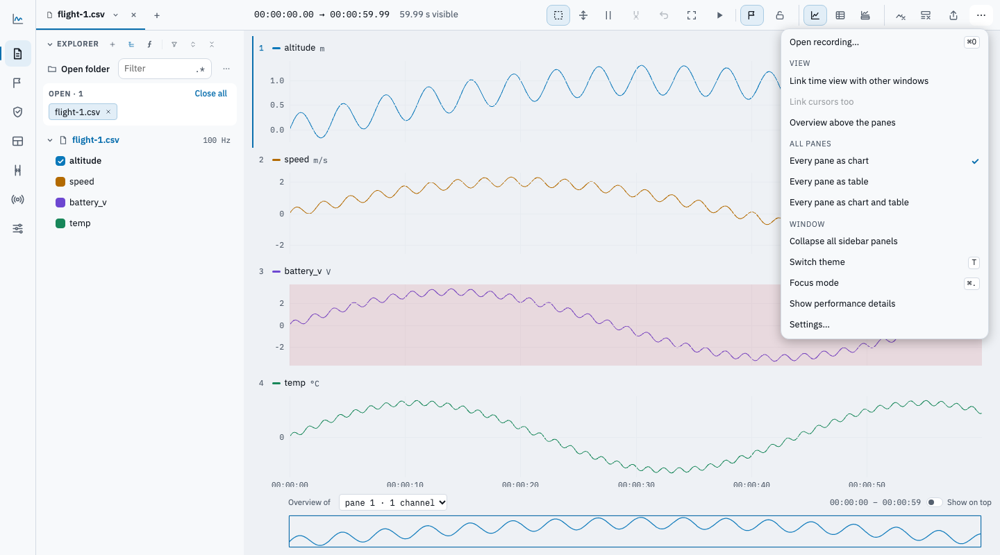

# Keyboard and mouse

Most actions have a shortcut, and the menu bar shows them beside each item. This chapter lists every shortcut, with the Mac form first and the Windows and Linux form second, and then the mouse gestures. `⌘` on a Mac is `Ctrl` elsewhere, `⌥` is `Alt`, `⇧` is `Shift`.

Shortcuts made of one key (`F`, `L`, `T`, `E`, `Esc`, `Backspace` and the rest) are never bound by the menu, so they don't stop you typing in a text field: they work when no text field has the focus.

## Menu shortcuts

The same table, generated from the app's command list, is in [Menu bar commands and shortcuts](../reference/shortcuts.md).

| Command | Mac | Windows and Linux |
| --- | --- | --- |
| **Open recording…** | `⌘O` | `Ctrl+O` |
| **Open folder…** | `⌘⇧O` | `Ctrl+Shift+O` |
| **Save layout** | `⌘S` | `Ctrl+S` |
| **Undo** | `⌘Z` | `Ctrl+Z` |
| **Redo** | `⌘⇧Z` | `Ctrl+Shift+Z`, or `Ctrl+Y` |
| **Settings…** | `⌘,` | `Ctrl+,` |
| **New pane** | `⌘⇧N` | `Ctrl+Shift+N` |
| **Duplicate pane** | `⌘D` | `Ctrl+D` |
| **Duplicate pane beside** | `⌘⇧D` | `Ctrl+Shift+D` |
| **Focus mode** | `⌘.` | `Ctrl+.` |
| Left sidebar, show or hide | `⌘B` | `Ctrl+B` |
| Measure, show or hide | `⌥⌘B` | `Ctrl+Alt+B` |

In a text field, `Undo` and `Redo` act on the field, not on the layout. **Undo** takes back the change the note at the bottom offers (a removed event, closed files), otherwise the last layout change.

## Single keys

These work when a file is open and no text field has the focus.

| Key | What it does |
| --- | --- |
| `F` | **Fit to the data** |
| `+` or `=`, `↑` | **Zoom in** (about the centre of the view) |
| `−`, `↓` | **Zoom out** |
| `←` `→` | Pan by 15% of the view |
| `Backspace`, `⌥←` (`Alt+←`) | **Back to the previous view** |
| `⌥→` (`Alt+→`) | Forward |
| `Esc` | **Clear cursors**; also closes a menu, a dialog or the start page, and leaves Focus mode |
| `Space` | Play back (opens the playback bar), when no button or field has the focus |
| `B` | **Box zoom** mode |
| `P` | **Pan** mode |
| `C` | **Cursors** mode |
| `A`, `B` | While the pointer is over a chart or a table row: place cursor A or B at the pointer's time (`B` is **Box zoom** anywhere else) |
| `E` | **Event markers**, on or off |
| `L` | **Lock the time view** (**Lock the view**), on or off |
| `T` | **Switch theme** |
| `End` | In a live tab: jump back to live |

The zoom and pan keys do nothing while the view is locked.

## In a table

| Key | What it does |
| --- | --- |
| `↑` `↓` | Scroll a row |
| `Page Up`, `Page Down` | Scroll a page |
| `Home`, `End` | First or last row |
| `⌘C` (`Ctrl+C`) | Copy the selected rows as CSV, when no text is selected |

## In Explorer and menus

| Key | What it does |
| --- | --- |
| `Enter`, `Space` | Open the file or folder, or plot the channel, under the focus |
| `⌘A` (`Ctrl+A`) | Select every channel shown |
| `Esc` | Clear the selection |
| `←` `→` on an open file | Collapse or expand its channels |
| `Enter` with several files picked | Open them all |
| `↑` `↓`, `Home`, `End` in a menu | Move through its items |

Clicking a row with `⌘` (`Ctrl`) adds it to the selection, and with `⇧` picks a range.

## Pane dividers

With the focus on a pane's bottom edge, `↑` and `↓` change its height by 10 px; on a table's edge, by 26 px.

## Mouse on charts

What a plain drag does depends on **Mouse mode**: **Box zoom**, **Pan** or **Cursors** (the top bar, **Settings**, or `B`, `P`, `C`).

| Gesture | What it does |
| --- | --- |
| Drag, in **Box zoom** mode | Draw a box over a time range, then zoom to it (a box under 4 px does nothing; the app says *Drag wider to zoom*) |
| Drag, in **Pan** mode | Move the time view |
| Drag, in **Cursors** mode | Place the nearer of cursors A and B and move it with the pointer |
| `Shift`-drag, or middle-button drag | Pan, in any mode |
| Drag a cursor line | Move that cursor, in any mode |
| Drag on a y-axis | Zoom that axis: up zooms in, down zooms out, about the point where you started |
| Wheel | Zoom the time view about the pointer. With **Scroll wheel zooms the charts** off, the wheel pans and `Ctrl`+wheel zooms |
| Sideways wheel or swipe | Pan |
| `Ctrl`+wheel (pinch on a trackpad) | Zoom in finer steps |
| `Shift`+wheel | Zoom the y-axis under the pointer (every axis of the pane over the plot) |
| Double-click a chart | **Fit to the data**, when **Double-click fits the whole recording** is on |
| Double-click a y-axis | Back to fitting what is in view |
| Double-click a pane's number or name | Rename the pane |
| Double-click a divider between panes | Reset that pane's height |
| Right-click a channel chip, or a channel in Explorer | The channel's menu |
| Right-click a pane's title | The pane's menu |
| Right-click a layout | Its menu (rename, share, delete) |
| Hover a chart | Read values at the pointer in the chips |

On the overview strip, the wheel zooms the time view about the pointer, and a drag follows the mouse mode: **Box zoom** draws a new view (a click centres on that point), **Pan** drags the window, **Cursors** places A and B.

A locked time view holds against all of these except cursors (when **Cursors still work while locked** is on) and y-axis zoom.

## Dragging

- Drag a channel from Explorer onto a pane to add it, or onto the space for a new pane to make one.
- Drag a tab to reorder it; drag it out of the tab bar to open it in its own window (see [windows](13-windows.md)).
- Drag a file onto the window to open it.

