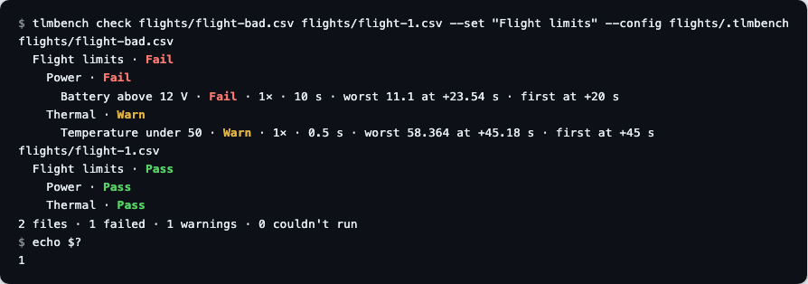

# The command line

`tlmbench` is the same core as the app, with no window. It reads recordings, queries them, converts them, runs check sets and exports HTML, so the numbers in a CI report are the numbers on screen. It never writes beside your recordings: the only writes are cache entries, the session folders `record` creates, and the files you name with `--out`.

## Install it

In the app, choose **Help › Install command-line tool…**. On macOS and Linux it links `tlmbench` into `~/.local/bin` (the dialog shows the line to add to your shell profile if that folder isn't on your `PATH`); on Windows it adds the app's folder to your user `PATH`. Open a new terminal afterwards.

Without the app, download the `tlmbench-<version>-<os>-<arch>` archive from the Releases page and put `tlmbench` on your `PATH`. [Installing TelemetryBench](../install.md) has the steps for each system, how to check a download, and the container image. Run `tlmbench --version` to check, and `tlmbench <command> --help` for any command.

## Exit codes

| Code | Meaning |
| --- | --- |
| 0 | Done |
| 1 | `check` only: a check failed |
| 2 | A file couldn't be read |
| 3 | A configuration error: a bad descriptor, expression, set name or argument |

`check` returns the highest code that applies.

## Options every command shares

These work on every command except `validate` and `record` (which has its own `--descriptor`), and some don't apply to every command.

| Option | What it does |
| --- | --- |
| `--descriptor <file>` | Format descriptor (TOML) for a fixed-width or packet file that has none |
| `--type <name>` | The packet type to read, for a packet file with several (default: all, in `info` and `convert`) |
| `--profile <file>` | Import profile for CSV files (JSON from the app cache, or TOML from `.tlmbench/profiles/`): names, units, types, the time column, the rate |
| `--cache <dir>` | Cache folder (default: `$TLMBENCH_CACHE`, else the system cache folder, shared with the app) |
| `--config <dir>` | A `.tlmbench/` folder to read shared configuration from, instead of the nearest one above each input. Repeat it; later ones win |
| `--derived` | Add the derived channels of the recipes marked automatic (from `--recipes`, else the nearest `.tlmbench/recipes`) |
| `--recipes <file or folder>` | A recipe file (TOML) or a folder of them. Repeat; later ones win a name |
| `--expr "name=expression"` | A derived channel from one expression. Repeat. (`derive` takes one expression with no name) |
| `--plugins <dir>` | Your plugins folder (default: `plugins/` in the app's data folder). WASM decoders and alignment plugins here, and in each `--config` folder's `plugins/`, are loaded |
| `--native-plugin <file>` | Turn on a native plugin of your plugins folder, by file name. Repeat. Each stays off until named |

Times (`--from`, `--until`, `--at`) are an ISO 8601 time, or seconds from the first sample.

## Commands

### `tlmbench info <files…>`

Channels, units, types, sample count, time range, time source and gaps of each file. `--json` prints one JSON object per file, one per line.

```sh
tlmbench info flight.tlm
tlmbench info --json runs/*.csv
```

### `tlmbench inspect <file>`

What a CSV file's import dialog would show, as JSON: its columns as detected, the first rows, the time column and rate, and the saved import profile for its header.

### `tlmbench query`

Reads a view, values or statistics. Each takes `<file>`, and `-c, --channel <name or number>` (repeat; default all).

| Subcommand | What it prints | Options |
| --- | --- | --- |
| `query view` | The points a chart of the span draws (M4, or raw samples when few), as CSV: `channel,time_ns,value` | `--from`, `--until`; `--width <px>` pixel columns (1000); `--gap-factor <n>` a time jump over this many median intervals breaks the line; `--coarse` from the pyramid alone, as a cold file first draws; `--raw-max <n>` return up to this many samples raw (0: only up to four per pixel column); `--connect-gaps` connect across gaps and add a `dashed` column |
| `query values` | Each channel's sample nearest a time, as CSV: `channel,index,time_ns,value` | `--at <time>` (required) |
| `query rows` | The rows of the span a table shows, as CSV: `row,time_ns`, then the channels | `--from`, `--until`; `--filter "channel=expression"` (repeat; all must pass; `> 1.5`, `1..2`, `blank`, joined with `and` or `or`; the channel `time` filters time in ns); `--sort "channel[:desc]"` (repeat; first is the main key); `--offset <n>` rows to skip (0); `--limit <n>` rows at most (1000) |
| `query stats` | Exact count, min, max, mean and standard deviation over a span, as CSV (builds the pyramid first) | `--from`, `--until` |

```sh
tlmbench query stats flight.tlm -c motor_rpm --from 10 --until 20
tlmbench query view flight.tlm -c motor_rpm --width 1200
tlmbench query rows flight.tlm -c volts --filter "volts=> 12" --sort volts:desc --limit 20
```

### `tlmbench derive <file> --expr "…"`

Evaluates one expression, given without a name, over a recording. It prints the series as CSV (`time_ns,value`), or one number for a whole-file expression. Takes `--from` and `--until`.

```sh
tlmbench derive flight.tlm --expr "battery_v * current_a"
```

### `tlmbench convert <files…> --to <format> --out <folder>`

Writes recordings as CSV, Parquet, Arrow IPC, HDF5 or MAT v7.3: one file per input in the output folder (created if missing), plus `<name>.channels.csv`.

| Option | What it does |
| --- | --- |
| `--to <format>` | `csv`, `parquet`, `arrow`, `hdf5` or `mat` (required) |
| `--out <dir>` | Folder for the output (required) |
| `-c, --channels <names>` | Channels by name, `*` matching any text; repeat or separate with commas (default: all) |
| `--from`, `--until` | The span |
| `--resample <rate>` | One row per step of this rate (`100Hz`, `2kHz`, or a number in Hz); each channel holds its last value. Can't be combined with `--layout long` |
| `--layout <wide or long>` | `wide`: a column per channel (default). `long` (CSV, Parquet, Arrow): one row per sample and channel |
| `--time <auto, seconds, iso or ns>` | How times are written. `auto`: exact; seconds for relative times, ISO 8601 for dates in CSV, nanoseconds in Parquet and Arrow |
| `--raw` | Stored values in their own type, without scale and offset |
| `--delimiter <char>` | CSV: the field delimiter (`,`) |
| `--units-row` | CSV: units in a second header row instead of `name [unit]` |
| `--jobs <n>` | Files converted at once (1) |
| `--json` | One JSON object per file written |

```sh
tlmbench convert runs/*.csv --to parquet --out out/ -c "motor_*" --resample 100Hz
```

### `tlmbench export html <files…> --out <path>`

Writes the viewer and the data as static files that open from any static host. The first file fills slot 1 of the layout, the next slot 2, and so on. See [exporting](12-exporting.md).

| Option | What it does |
| --- | --- |
| `--out <path>` | The folder to write (created; an existing export in it is replaced), or with `--single-file`, the file |
| `--layout <name or file>` | A shared view (in `.tlmbench/views`) by name or file name, or a view file. Without one the viewer starts as the app does on opening the file |
| `--all-channels` | Include every channel, not only the layout's |
| `--redact <channels>` | Leave these channels out everywhere, even if the layout uses them. Repeat or separate with commas |
| `--checks <set>` | Run a check set on each file and include its summary, with violations marked. Repeat |
| `--from`, `--until` | The time range |
| `--budget <size>` | Size budget of the folder (`250MB`, `1GB` or bytes). Default 250MB |
| `--mode <full or light>` | `full`: raw samples for every channel. `light`: raw samples only for channels shown as tables, values or XY. By default Full when it fits the budget, else Light |
| `--detail <spec>` | Light's raw windows around events and violations: `30s` (the minimum width), or `3x,30s,10min` (factor, minimum, cap); `0` turns them off. Default `3x,30s,10min` |
| `--single-file` | One HTML file for email or `file://`: every raw sample when they fit `--single-limit`, else Light with the finest levels left out |
| `--single-limit <size>` | The limit of a `--single-file` export. Default 25MB |
| `--connect-gaps` | The viewer connects the line across gaps, dashed |
| `--viewer <dir>` | A viewer folder to copy instead of the built-in one (also `$TLMBENCH_VIEWER`) |
| `--no-viewer` | Write the data only |
| `--json` | The result as one JSON object |

```sh
tlmbench export html flight.tlm --out site/ --layout "Flight review" --checks "Flight acceptance"
tlmbench export html flight.tlm --out report.html --single-file
```

### `tlmbench check <paths…>`

Runs check sets (and the rules in them) on recordings, or on the recordings in folders (in name order), and prints a summary: files, failed, warnings, couldn't run.

| Option | What it does |
| --- | --- |
| `--set <name>` | The set to run, by name (repeat). Found in `--sets-from`, else the nearest `.tlmbench/checks` above the first path, else the app's own sets |
| `--sets-from <file or folder>` | A set file (TOML) or a folder of them. Repeat |
| `--sets-from-profile` | Also run the sets each CSV file's import profile names, so CI and the app agree |
| `--report <kinds>` | Reports to write into `--out`: `junit` (`junit.xml`), `csv` (`results.csv`), `json` (`results.json`), `html` (`report.html`). Comma-separated or repeated. Needs `--out` |
| `--out <dir>` | Where the reports go (created if missing) |
| `--views` | With `--report html`: write a Light HTML export of each failing file into `<out>/views/` and link each failing cell to its first violation. The sets must be found by name in a `.tlmbench/checks` folder |
| `--jobs <n>` | Files checked at once (1) |
| `--fail-on <fail or warn>` | `warn` counts a warning as a failure (default `fail`) |
| `--allow-cant-run` | A check that can't run (a channel is missing) doesn't fail the build |
| `--watch` | Watch the folders: check each new recording once it is complete, writing its reports to `<out>/<file name>/`. Runs until stopped; exits with the worst result seen |
| `--settle <seconds>` | With `--watch`: how long a new file's size must hold still before it counts as complete (2) |
| `--stop-after <seconds>` | With `--watch`: stop after this long |

Exit code: 0 all pass, 1 a check failed (a warning too with `--fail-on warn`), 2 a file couldn't be read or a check couldn't run, 3 a configuration error.

```sh
tlmbench check runs/ --set "Flight acceptance" --report junit,html --out reports/
```

### `tlmbench validate [dir]`

Lints a `.tlmbench/` folder (the nearest above the current directory by default, or the folder that holds one): every file that doesn't read, and recipes and checks whose expressions don't parse. Prints `<folder>: ok` and exits 0, or lists the problems on stderr and exits 3. Suits a pre-commit hook or a CI step.

### `tlmbench config export --out <dir>`

Writes what the app holds, so CI uses exactly what you tested with: recipes, check sets, import profiles, decoders and time maps, and, as the app last saved them, event categories, widgets, icons, layouts and the events of the recordings it had open. The folder becomes a `.tlmbench/` (created if missing). Only changed files are written. Takes `--cache`.

### `tlmbench record <endpoint>`

Records a live source into a new session folder until it ends or `--seconds` pass, and prints its stream health.

| Option / argument | What it does |
| --- | --- |
| `<endpoint>` | `tcp://host:port` (connects), `udp://host:port` (listens), `serial://port?baud=rate` (115200 baud if not given), or `file:///path` (follows a growing CSV or `.tlm` from its start; only read) |
| `--descriptor <file>` | The frames' format descriptor (TOML). Sockets and serial ports need one; files bring their own |
| `--out <dir>` | Where the session folder goes (default `$TLMBENCH_RECORDINGS`, else the app's Recordings folder) |
| `--seconds <n>` | Stop after this many seconds |
| `--idle-end <n>` | UDP: stop once no datagram has come for this long; a file: once it hasn't grown for that long |
| `--ring-mb <n>` | The ring buffer's size in MB (default: about 10 s of the descriptor's rate) |
| `--reconnect` | TCP and serial: connect again whenever the link drops, until stopped (frames sent meanwhile are lost) |
| `--json` | The result as one JSON object |

### `tlmbench cache`

| Subcommand | What it does |
| --- | --- |
| `cache build <files…>` | Build each file's pyramid and gap index (resumes an interrupted build). `--quiet`: no progress on stderr |
| `cache list` | Every cache entry, most recently opened first. `--json` |
| `cache clear` | Remove every entry no program has open |

### `tlmbench plugins`

Lists the plugins found in your plugins folder and the `--config` folders, with tier, version and whether they loaded. `--json` prints JSON.

`tlmbench plugins --check <plugin.wasm> [file]` tries one plugin instead: what it says about itself and, with a file, what it decodes (schema, samples, time range) or why it can't. For writing a plugin.

## Environment

| Variable | Used for |
| --- | --- |
| `TLMBENCH_CACHE` | The cache folder, when `--cache` isn't given |
| `TLMBENCH_RECORDINGS` | Where `record` puts session folders, when `--out` isn't given |
| `TLMBENCH_VIEWER` | A viewer folder for `export html`, when `--viewer` isn't given |


