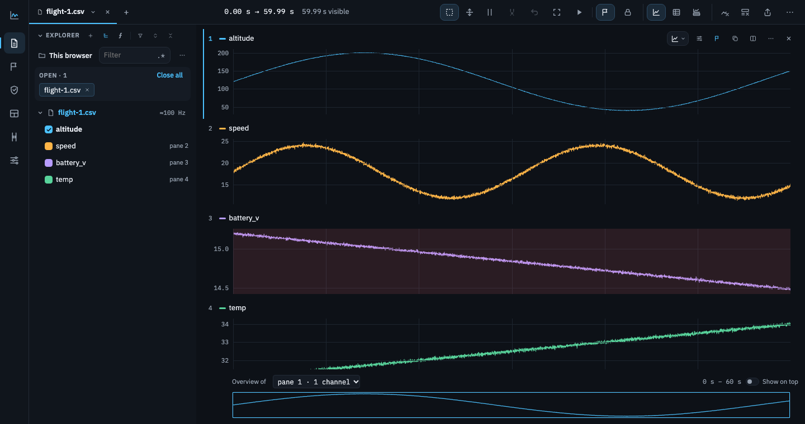
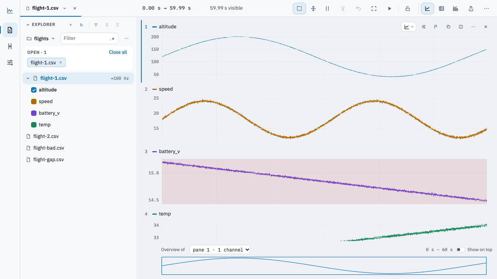

# Browser-only mode

Browser-only mode is TelemetryBench in a browser tab, with nothing to install. It is the same interface as the app, with the core compiled to WebAssembly and running in the page. Nothing is uploaded (the page has no server behind it), and nothing is written beside your data. Choose a file or drop one on the page. It is a good way to look at a recording on a machine where you can't install software, or to give someone a link.



## What it reads

- **CSV**, by the decoder's own reader, so units in the header, the time column and time that goes backwards read as in the app.
- **Reference files** (`.tlm`), with their own header, descriptor and time code.
- **Parquet**: snappy, LZ4, gzip, brotli and Zstandard, with the app's rules for the time column, units and nulls. The reader is a separate module of about 1 MB that the page fetches only when a Parquet file opens.
- **Fixed-width and packet files through descriptors**. A descriptor is kept in the browser and found by file name.
- **WASM decoder plugins**, run in the browser's own WebAssembly engine under the app's sandbox limits. Add one in **Settings** under **Plugins** with **Add plugin…**; **Remove** takes it away. A native plugin shows *Needs the app: a browser tab runs WASM plugins only*.

The parse runs in a Worker, so a big file doesn't freeze the tab. What was read is kept in the browser's private storage; the same file opens from it next time, and a reload brings back the files that were open. **Settings › Clear cache** empties it.

## Folders

In browsers that have the folder picker (Chromium-based browsers; not Firefox or Safari), **Open folder…** lists a folder in Explorer, read-only: the picker asks for read access only, and nothing is written to the folder. Sub-folders and the files the app can read are listed; dot folders are left out. A file opens from its handle. The folder is remembered, and after a reload the browser asks for permission again. Where there is no picker, the start page says so and offers **Open recording…**.

A folder's `.tlmbench/` is read too, read-only: its event categories, widgets and icons are used as in the app, and its `decoders/` are found first when a binary file needs one. Plugins the folder shares load only when you trust the folder. Recipes, check sets, layouts and events in the folder aren't used in a tab.

## What needs the app

A tab shows only controls that can act. These need the app, and are left out:

- Live sources, recording, and browser access.
- Native plugins.
- Writing shared configuration: **Share…**, **Save** and **Export file…**.

These come after v1, and are left out for now: several files in one tab with alignment, derived channels, events, rules and checks, and saved layouts. In the tab that means no Live, Layouts or Rules & checks in the rail; no **Derive**, **Compare**, **Open together** or **Add to tab**; and no Checks view for a pane. **Settings** leaves out what it can't do.

## Hosting it

The page is a folder of static files with relative paths. Serve it from any folder of any static host. The release has `tlmbench-<version>-browser-site.zip`; to build it yourself:

```sh
just browser-site          # builds app/browser/dist
python3 -m http.server --directory app/browser/dist
```

and open `http://localhost:8000`. A browser runs WebAssembly and Workers only from a web address, not from a file opened from disk, so the folder needs a host or a local server. For GitHub Pages, publish `app/browser/dist` with the standard Pages action.


